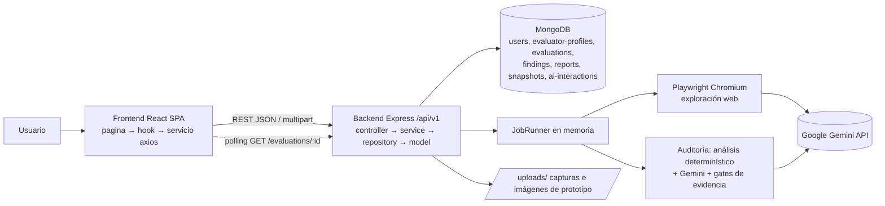

# Análisis técnico y metodológico de EvalUXIA para el documento maestro (Fase 3)

> Documento de trabajo para revisión y contraste. **No es texto definitivo** para copiar al documento maestro.
> Fecha del análisis: 2026-10-12. Autora del proyecto: Isis Coromoto Ríos Buitrago.

**Convención de etiquetas usada en todo el documento**

| Etiqueta | Significado |
|---|---|
| **[HECHO]** | Comprobado por mí en esta sesión leyendo código/archivos o ejecutando un comando. |
| **[HECHO-SEC]** | Tomado de un documento previo (p. ej. `INFORME_ESTADO_ARQUITECTURA.md`); no re-verificado por mí. |
| **[INFERENCIA]** | Deducción razonable a partir de evidencia, no comprobada directamente. |
| **[PROPUESTA]** | Sugerencia mía; requiere validación por la autora y/o el tutor. |
| **[PENDIENTE]** | Falta información; no se completa con suposiciones. |

---

## 1. Resumen ejecutivo

1. **El software existe y es sustancialmente más amplio que el MVP "solo URL"** descrito en el informe del 2026-09-15. El repositorio del frontend (`/Users/isisrios/Proyectos/React/evaluxia`) y el del backend (`/Users/isisrios/Proyectos/Node/evaluxia_backend`) son dos proyectos independientes. **[HECHO]**
2. **Discrepancia importante con el informe del 15-sep:** ese informe afirma que la evaluación de prototipos por imagen "NO está implementada". En el árbol de trabajo actual **sí hay código** de ese módulo (backend: `POST /api/v1/evaluations/prototype`, carga multer, auditoría multimodal con Gemini, gates visuales; frontend: ruta `/evaluate/prototype` y `EvaluatePrototypePage.tsx`). **Pero todo ese código está sin commitear** (`git status` en ambos repos) y no encontré evidencia de una ejecución real de extremo a extremo con Gemini sobre un prototipo (existe un runner gated por variable de entorno, no hay resultados guardados). Debe documentarse como *"implementado en código, validado con pruebas con mocks; validación con Gemini real pendiente/no evidenciada"*. **[HECHO]**
3. **No existe en el software ningún módulo SUS ni de encuestas** (búsqueda en `src/` de ambos repos). Esto **no es un problema metodológico**: SUS y el cuestionario diagnóstico son instrumentos de la *investigación* aplicados a participantes, y pueden administrarse con una herramienta externa. La propuesta F-7-9-1 lo respalda ("Instrumentos digitales … $0"). El informe del 15-sep lo planteaba como un módulo a construir; eso es una decisión adicional, no un requisito de la propuesta. **[HECHO] + [INFERENCIA]**
4. **La metodología de investigación aprobada (F-7-9-1, §9.1) es mixta, aplicada, con DCU, pruebas de usabilidad con tareas + Think-Aloud + SUS y ~5 voluntarios.** No incluye un *cuestionario diagnóstico de necesidades*. El tutor pide ahora un cuestionario de ≥15 preguntas y n=30. **Hay una tensión real (5 vs. 30 participantes; dos instrumentos distintos) que debe aclararse con el tutor antes de cerrar el apartado** (§7, §8, §16).
5. **Nada de la fase empírica con participantes tiene evidencia de haberse ejecutado.** El diagnóstico debe redactarse como procedimiento de análisis, sin resultados.
6. **Sobre las referencias:** no pude verificar externamente DOIs, citas textuales ni datos bibliográficos en esta sesión (no consulté las fuentes originales). Detecté inconsistencias internas en el documento de investigación bibliográfica (§14). Ninguna cita textual debe copiarse como literal sin cotejarla con el PDF original.

---

## 2. Materiales consultados y limitaciones del análisis

### 2.1 Consultados

| Material | Cómo se usó | Estado |
|---|---|---|
| Repo frontend `/Users/isisrios/Proyectos/React/evaluxia` (`package.json`, `vite.config.ts`, `src/routes/index.tsx`, estructura `src/`, `git log`, `git status`, `git diff --stat`) | Inventario técnico | Leído |
| Repo backend `/Users/isisrios/Proyectos/Node/evaluxia_backend` (`package.json`, `Dockerfile`, `docker-compose.yml`, `src/app/app.ts`, `src/config/*`, rutas y DTO de evaluaciones, modelos de perfil/evaluación, `prototype-*` services, `ai.service.ts` (fragmentos), `gemini.client.ts` (fragmentos), `job-runner.ts`, estructura de `src/`, `fixtures/`, `git log/status`) | Inventario técnico | Leído parcialmente (lectura dirigida, no de todos los archivos) |
| `INFORME_ESTADO_ARQUITECTURA.md` (frontend, 2026-09-15) | Fuente secundaria; contrastado con código | Leído completo |
| Propuesta F-7-9-1 (versión (12), 44 págs.) | Decisiones aprobadas | Leída completa |
| «investigación bibliográfica para fundamentar Marco Metodológico.rtf» | Punto de partida bibliográfico | Leído completo |
| Guía de aprendizaje Fase 3 | Estructura exigida | Leída completa |
| `~/Downloads/Guia Metodologica Doc Maestro - Proyecto de grado - Copia.pdf` | Plantilla de estructura (Metodología, Diseño de la solución) | Leída parcialmente |
| `~/Downloads/EVALUXIA_MASTER_CONTEXT.md` | Solo primeras líneas | **No usado como evidencia** |
| Indicaciones del tutor (las que usted pegó en el prompt) | Restricciones del instrumento | Tomadas como las transmitió usted; **no verificadas con el tutor** |

### 2.2 Comandos efectivamente ejecutados

- `npx vitest run` en el frontend: **5 archivos, 20 pruebas, todas pasaron** (v5.0.0, ~3.8 s). **[HECHO]**
- **No ejecuté** las pruebas del backend (son scripts `ts-node`; varias requieren MongoDB, Playwright o Gemini), **ni** compilé (`tsc`), ni levanté el sistema, ni hice evaluaciones. Todo lo dicho sobre el comportamiento del backend proviene de lectura de código.

### 2.3 No revisado / no accesible

- No revisé el contenido de `uploads/` (202 archivos de capturas) ni la base de datos MongoDB real (por tanto, no sé cuántas evaluaciones reales existen).
- No leí `AUDITORIA_TECNICA_FUNCIONAL_EVALUXIA.txt` (74 KB, sin commitear) ni los `implementation_plan_*.md` de Descargas.
- No abrí `Anexo 3 - Plantilla Gestion de Proyectos Agiles.xlsx` ni `Anexo 4 - Informe Gestión del Proyecto.docx` (existen en Descargas). **Podrían ser evidencia valiosa de la gestión ágil real** (ver §10).
- No consulté fuentes externas (DOI, sitios de fabricantes, bibliografía). No hice búsquedas web.
- `AUDITORIA_...` aparece como `.txt` en el repo y como `.md` en Descargas; no comparé versiones.

---

## 3. Estado real del software y funcionalidades verificadas

### 3.1 Arquitectura de repositorios

| Repo | Ruta | Commits | Estado de `git status` |
|---|---|---|---|
| Frontend | `/Users/isisrios/Proyectos/React/evaluxia` | 10 (último: 2026-09-06, "Phase C.1 report value and token tracking") | 7 archivos modificados + `PrototypeEvaluationForm(.test).tsx`, `EvaluatePrototypePage(.test).tsx`, `useEvaluations.prototype.test.ts` sin trackear |
| Backend | `/Users/isisrios/Proyectos/Node/evaluxia_backend` | 12 (último: 2026-09-06, "Phase C.1 …") | 19 archivos modificados (≈2 493 inserciones) + muchos sin trackear (servicios `prototype-*`, `visual-evidence-*`, `evidence-*`, `fixtures/`, pruebas) |

**[HECHO]** Consecuencia para el documento: el historial git **no refleja** el trabajo reciente (prototipos, hardening). Si se usa git como evidencia de iteraciones, conviene commitear antes (decisión de la autora).

### 3.2 Matriz de funcionalidades

| # | Funcionalidad | Estado | Evidencia | Observaciones |
|---|---|---|---|---|
| F1 | Autenticación JWT (access/refresh), registro/login | Implementada en backend. Frontend: login + `authSlice` | `src/modules/auth/*`, `src/config/env.ts` (`JWT_ACCESS_EXPIRES_IN` 15m, `JWT_REFRESH_EXPIRES_IN` 7d); frontend `src/features/auth/authSlice.ts`, `LoginPage.tsx` | **[HECHO]**. El `apiClient.ts` del frontend deja el refresh automático como comentario ("Listo para implementar … en una iteración posterior"): **no implementado en el frontend**. No hay ruta de registro en el frontend (`src/routes/index.tsx`). |
| F2 | CRUD de perfiles evaluadores | Implementado (backend + frontend) | `src/modules/evaluator-profiles/*`; frontend `src/pages/UserEvaluatorProfiles/*`, `src/components/evaluator-profiles/*` | Campos del perfil verificados en `evaluator-profile.model.ts`: nombre, frase, edad, profesión, estado civil, país, ciudad, arquetipo, biografía, personalidad, metas, frustraciones, `techSavviness` (low/medium/high), `accessibilityNeeds[]`, `preferredDevice` (desktop/mobile/tablet), `isActive`. **[HECHO]** |
| F3 | Evaluación de sitio web por URL (exploración con Playwright + decisión con IA + auditoría) | Implementada | Rutas `POST /api/v1/evaluations`; `src/modules/automation/*`, `src/infrastructure/playwright/browser.manager.ts`, `services/rule-engine.service.ts`, `services/dynamic-iterations.service.ts`, `services/audit-engine.service.ts`, `services/deterministic-analyzer.service.ts`, `services/evidence-gate.service.ts` | Existencia de archivos y rutas **[HECHO]**. Descripción del pipeline en dos fases (3–8 iteraciones, motor de reglas antes de Gemini, "Evidence Gate") proviene de `INFORME_ESTADO_ARQUITECTURA.md` **[HECHO-SEC]**; solo verifiqué parcialmente el código. |
| F4 | Validación anti-SSRF de URLs | Implementada | `src/shared/security/url-guard.ts`, usada en `CreateEvaluationSchema` (`assertSafeUrl`) | **[HECHO]** (uso en DTO). Alcance del bloqueo (rangos privados, redirecciones) **[HECHO-SEC]**; hay prueba `url-guard.test.ts`. |
| F5 | Heurísticas de Nielsen + criterios WCAG 2.2 (auditoría por IA) | Implementada en prompt | `src/modules/ai/ai.service.ts` líneas ~748-756: WCAG 1.1.1, 1.3.1, 1.4.1, 1.4.3, 2.4.4, 2.4.6, 3.3.2, 4.1.2; comentarios sobre 2.1.1 y 3.2.2 no evaluables por IA | **[HECHO]**. Son **8 criterios en el prompt** (no 7 como dice el informe del 15-sep). Los **10 de Nielsen** como criterio del prompt los da el informe **[HECHO-SEC]**; verificar en `ai.service.ts`. |
| F6 | Verificaciones determinísticas (contraste, alt, nombre accesible…) | Implementada | `services/deterministic-analyzer.service.ts` y pruebas `deterministic-analyzer-{buttons,forms,images}.test.ts` | Existencia **[HECHO]**; fórmula W3C de contraste **[HECHO-SEC]**. |
| F7 | Puntaje global determinístico | Implementada | `services/audit-metrics.service.ts` ~L597-615: `overallScore = round(baseQuality × gammaCoverage)` acotado 0–100 | **[HECHO]**. La fórmula completa de `baseQuality`/`gammaCoverage` no fue analizada. |
| F8 | Hallazgos con severidad/estado/confianza, evidencias, reportes, snapshots | Implementada | módulos `findings`, `reports`, `snapshots`; modelos Mongoose | **[HECHO]** (existencia). |
| F9 | Seguimiento de tokens/costos de IA | Implementada | `src/modules/ai-interactions/*`, `shared/infrastructure/metrics-tracker.ts`; commit "Phase C.1 report value and token tracking" | **[HECHO]**. |
| F10 | Evaluación de **prototipo por imagen** | **Implementada en código, sin commitear; sin evidencia de ejecución real** | Backend: `POST /prototype` en `evaluation.routes.ts`, `middleware/prototype-upload.middleware.ts` (multer, memoria), `services/prototype-image-upload.service.ts`, `prototype-evaluation.service.ts`, `prototype-criteria-resolver.ts`, `visual-evidence-gate.service.ts`, `visual-evidence-consistency.service.ts`, `prototype-metrics.service.ts`, `ai/contracts/prototype.contracts.ts`; `AiService.performPrototypeAuditAnalysis` → `GeminiClient.generateMultimodalStructuredWithUsage` (envía `inlineData`). Frontend: ruta `/evaluate/prototype`, `EvaluatePrototypePage.tsx`, `PrototypeEvaluationForm.tsx` | **[HECHO]**. Un comentario en `prototype-evaluation.service.ts` (~L99-104) dice "NUNCA una llamada real en esta fase … siempre mockeado": describe la política de las *pruebas*; el código de producción sí invoca el cliente multimodal. Fixtures: `fixtures/prototypes/{checkout-mock,p7-heading-label}.png` + ground truth. El runner `prototype-p7-real-gemini-run.ts` solo llama a Gemini si `PROTOTYPE_P7_EXPERIMENT_1_AUTHORIZED=yes`; **no hay evidencia de que se haya ejecutado**. |
| F11 | Criterios aplicables a prototipos con política de cobertura | Implementada | `prototype-criteria-resolver.ts`: cada criterio es `DIRECTLY_EVALUABLE`, `PARTIALLY_EVALUABLE` u `OUT_OF_COVERAGE`; contraste 1.4.3 solo observación visual (prohíbe calcular razón numérica) | **[HECHO]**. Es un **diseño relevante para la tesis** (límites honestos de la evaluación visual). |
| F12 | Historial de evaluaciones | Implementada (frontend) | `src/pages/History/HistoryPage.tsx` (modificado, sin commitear) | **[HECHO]**. |
| F13 | Timeline de iteraciones con capturas, panel de evidencias/métricas | Implementada | `IterationTimeline.tsx`, `FindingsAccordion.tsx`, `EvaluationSummary.tsx`; commits 3E/3F | **[HECHO]** (existencia de componentes). |
| F14 | Ejecución de "flujos" por descripción libre | Parcial/deshabilitada | Modelo `flowDefinition/flowState` en `evaluation.model.ts`; frontend sin ruta `/evaluate/flow` | **[HECHO]** (no hay ruta). |
| F15 | Cola de trabajos | **En memoria (`setImmediate`)**, no persistente | `shared/infrastructure/job-runner.ts` (comentario: "MVP … futura migración a BullMQ") | **[HECHO]**. Limitación declarable. |
| F16 | Módulo SUS / encuestas | **No existe** | búsqueda en `src/` de ambos repos | **[HECHO]** |
| F17 | CI/CD | No evidenciado | sin `.github/` en lo inspeccionado | **[HECHO-SEC]** |

### 3.3 Frontend: rutas existentes (`src/routes/index.tsx`) **[HECHO]**

`/login`, `/inicio`, `/historial`, `/perfiles`, `/perfiles/nuevo`, `/perfiles/:id/editar`, `/evaluate/web`, `/evaluate/prototype` (esta última sin commitear).

### 3.4 Pruebas

| Repo | Marco | Hallazgo | Estado |
|---|---|---|---|
| Frontend | Vitest 5 + jsdom + Testing Library | 5 archivos de prueba; **20 pruebas, todas pasan** (ejecutado hoy) | **[HECHO]** |
| Backend | Scripts `ts-node` individuales, sin framework | 86 archivos `*.test.ts` + ~10 runners/inspecciones. `npm test` ejecuta **solo** `src/modules/ai/tests/contracts.test.ts` | **[HECHO]** (conteo y script). **No ejecuté ninguna.** Por tanto **no puedo afirmar tasa de aprobación ni cobertura**. |

Nota: `jest` aparece en `devDependencies` del frontend pero las pruebas usan Vitest. **[HECHO]**.

---

## 4. Arquitectura y tecnologías

### 4.1 Inventario (versiones = rango en `package.json`, no versión instalada)

**Frontend** **[HECHO]**

| Tecnología | Versión (rango) | Función | Evidencia | Estado |
|---|---|---|---|---|
| React / React DOM | ^19.1.0 | UI (SPA) | `package.json` | Implementada |
| TypeScript | ~5.8.3 | Lenguaje | `tsconfig*.json` | Implementada |
| Vite + `@vitejs/plugin-react` | ^6.3.5 / ^4.4.1 | Servidor dev y build; alias de rutas (`@pages`, `@services`, …) | `vite.config.ts` | Implementada |
| React Router DOM | ^7.6.2 | Enrutamiento, rutas privadas (`PrivateRoute.tsx`) | `src/routes/index.tsx` | Implementada |
| MUI (+ Emotion, icons) | ^7.1.x | Componentes UI | `package.json`, `src/theme.ts` | Implementada |
| Tailwind CSS | ^4.1.10 | Utilidades CSS | `tailwind.config.js`, `postcss.config.js` | Configurada (alcance de uso no medido) |
| Redux Toolkit, react-redux, redux-persist | ^2.8 / ^9.2 / ^6.0 | Estado de sesión y perfil activo | `src/app/store.ts`, `src/features/*` | Implementada |
| react-hook-form + Yup | ^7.58 / ^1.6 | Formularios y validación | `package.json` | Instalada; uso en formularios **[INFERENCIA]** |
| axios | ^1.17.0 | Cliente HTTP | `src/services/api/apiClient.ts` | Implementada |
| framer-motion, lottie-react | ^12 / ^2.4 | — | `grep` en `src/`: **sin usos** | **Instaladas, no usadas** (no listar como parte de la solución) |
| Vitest, jsdom, Testing Library | ^5 / ^30 / ^16 | Pruebas | `vite.config.ts` (`test.environment: 'jsdom'`) | Implementada |
| ESLint + typescript-eslint | ^9 / ^8 | Calidad estática | `eslint.config.js` | Configurada |

**Backend** **[HECHO]**

| Tecnología | Versión (rango) | Función | Evidencia | Estado |
|---|---|---|---|---|
| Node.js (imagen `node:20-slim`) | 20 | Runtime | `Dockerfile` | Implementada |
| Express | ^5.1.0 | API REST bajo `/api/v1` | `src/app/app.ts` | Implementada |
| TypeScript, ts-node-dev, tsconfig-paths | ^5.8.3 | Lenguaje y desarrollo | `package.json` | Implementada |
| MongoDB + Mongoose | ^8.0.0 (`mongo:7` en compose) | Persistencia | `docker-compose.yml`, `src/infrastructure/database/mongodb.ts`, `*.model.ts` | Implementada |
| Playwright (Chromium headless) | ^1.60.0 | Navegación automatizada y extracción de DOM/capturas | `src/infrastructure/playwright/browser.manager.ts`, `Dockerfile` (`playwright install --with-deps chromium`) | Implementada |
| `@google/genai` (Gemini) | ^1.3.0; modelo por defecto `gemini-2.5-flash` (`GEMINI_MODEL`) | LLM: decisión de acciones y auditoría; multimodal para prototipos | `src/config/env.ts`, `src/infrastructure/gemini/gemini.client.ts` | Implementada |
| Zod | ^3.23.8 | Validación de DTO y de salidas de IA; validación de entorno al arranque | `*.dto.ts`, `*.contracts.ts`, `env.ts` | Implementada |
| jsonwebtoken + bcryptjs | ^9 / ^3 | Tokens y hash de contraseñas | `src/modules/auth/*` | Implementada |
| helmet, cors, morgan | ^8 / ^2.8 / ^1.10 | Seguridad HTTP y logging | `app.ts`, `logger.middleware.ts` | Implementada |
| multer + image-size | ^2.4 / ^2.0 | Carga y verificación de imágenes de prototipo | `prototype-upload.middleware.ts`, `prototype-image-upload.service.ts` | Implementada (sin commitear) |
| Docker / docker-compose | — | Ejecución local: servicios `api`, `mongo:7`, `mongo-express` | `Dockerfile`, `docker-compose.yml` | Implementada (self-hosted) |
| `@playwright/test` | ^1.52 | devDependency; uso no verificado | `package.json` | Instalada |

**No evidenciado:** despliegue en nube, CI/CD, cola persistente (BullMQ/Redis), almacenamiento externo de imágenes (se sirve `/uploads` estático desde disco). **[HECHO]/[HECHO-SEC]**

### 4.2 Arquitectura lógica (comprobada a nivel de módulos; flujo detallado según informe secundario)

- Capas y módulos: **[HECHO]** (`src/modules/{auth,users,evaluator-profiles,evaluations,findings,reports,snapshots,automation,ai,ai-interactions}`).
- Polling desde el frontend (sin WebSockets/SSE) y el pipeline de dos fases: **[HECHO-SEC]**; hay variable `VITE_POLLING_INTERVAL_MS` en `.env.local` del frontend **[HECHO]** (valor no reproducido aquí).
- Existe además un `automationRoutes` y `aiRoutes` montados (`/automation`, `/ai`) cuyo propósito/exposición no analicé. **[PENDIENTE]**

### 4.3 Diferencias frente a la propuesta F-7-9-1

| Aspecto | Propuesta | Código | Diferencia |
|---|---|---|---|
| Stack (React+Vite+TS, Node+Express+TS, MongoDB, Playwright, Gemini, JWT, Docker) | Declarado (§9.2, §11) | Coincide | Ninguna |
| MUI | Declarado | Presente (+ Tailwind, no declarado) | Menor |
| Prototipos por imagen | Mes 5-6 del cronograma | Ya implementado en código (sin commitear) | Adelantado respecto al cronograma; sin validación real |
| SUS | Instrumento de validación | No hay módulo en el software | Coherente (instrumento externo) |
| Heurísticas Nielsen + WCAG 2.2 | Declaradas | Presentes en prompt (8 criterios WCAG) | Documentar la lista exacta y los criterios "no evaluables" |
| Perfiles evaluadores = contexto de IA, no agente | Declarado | Perfil entra al prompt (`prototype-evaluation.service.ts` lo pasa como `archetype`) | Coherente |

---

## 5. Base documental para el marco tecnológico

Propuesta de organización (no redactar como lista de herramientas). Para cada categoría: necesidad que atiende → papel en la arquitectura → evidencia → tipo de fuente necesaria.

| Categoría | Tecnologías | Necesidad del proyecto | Evidencia en código | Fuente requerida |
|---|---|---|---|---|
| **A. Interfaz de usuario (construcción)** | React 19, TypeScript, Vite, MUI, React Router, Redux Toolkit | Aplicación web de configuración y consulta de resultados (objetivo específico 3 y 4) | `package.json`, `src/` | Documentación oficial de cada tecnología (no hace falta literatura académica); la elección se justifica con el código |
| **B. Servicio de aplicación** | Node.js, Express 5, TypeScript, Zod | API REST, validación de entradas y contratos con IA | `app.ts`, `*.dto.ts` | Documentación oficial; justificar capas (controller/service/repository) con el código |
| **C. Persistencia** | MongoDB, Mongoose | Almacenar evaluaciones con documentos heterogéneos (snapshots, hallazgos, evidencias) | `*.model.ts` | Documentación oficial; **la afirmación "MongoDB es adecuado por esquema flexible" necesita fuente o debe omitirse** |
| **D. Automatización de la evaluación** | Playwright + Chromium | Exploración reproducible, capturas y extracción de DOM/accesibilidad | `browser.manager.ts`, `automation.service.ts` | Documentación oficial de Playwright + soporte académico para evaluación automatizada (Dias et al., 2022; Huda et al., 2025 — ya en la propuesta) |
| **E. Inteligencia artificial** | Google Gemini (`@google/genai`), salida estructurada con Zod, modo multimodal | Decisión de acciones, interpretación semántica, análisis visual de prototipos | `gemini.client.ts`, `ai.service.ts` | Documentación oficial de Gemini para capacidades/modelos + literatura (Wang et al., 2024; Vera-Amaro & Rojano-Cáceres, 2025). **No afirmar precisión de Gemini sin evidencia.** |
| **F. Controles de fiabilidad de la IA** | Evidence Gate, consistencia visual, cardinalidad por criterio WCAG, puntaje determinístico | Mitigar falsos positivos/alucinaciones, que la literatura reconoce como limitación | `evidence-gate.service.ts`, `visual-evidence-gate.service.ts`, `wcag-criterion-cardinality.ts` | Son **diseño propio**: se sustentan en el código; la motivación en Vera-Amaro & Rojano-Cáceres (2025) |
| **G. Seguridad** | JWT, bcrypt, helmet, cors, anti-SSRF, validación de carga de imágenes | Proteger sesiones y evitar que la plataforma navegue destinos peligrosos | `auth.service.ts`, `url-guard.ts`, `prototype-image-upload.service.ts` | Documentación oficial; (opcional) OWASP — **fuente por verificar** |
| **H. Ejecución, pruebas y despliegue** | Docker, docker-compose, Vitest, scripts ts-node, fixtures de DOM | Reproducir entorno; verificar comportamiento | `Dockerfile`, `docker-compose.yml`, `fixtures/`, `src/shared/testing/` | Código; separar "tecnologías para construir" (A–G) de "para ejecutar/probar" (H) |

**Afirmaciones que se pueden sustentar solo con el código:** qué módulo hace qué, qué criterios WCAG evalúa el prompt, existencia de gates y de la política de cobertura de prototipos.
**Afirmaciones que requieren fuente:** ventajas generales de cada tecnología, capacidades de Gemini, relación entre LLM y evaluación de accesibilidad.
**Precauciones:** no atribuir a Playwright o Gemini beneficios "demostrados" (ahorro de tiempo, precisión) sin evidencia empírica del propio proyecto.

---

## 6. Metodología de investigación formulada (según F-7-9-1 §9.1)

| Elemento | Lo que dice la propuesta | Clasificación |
|---|---|---|
| Enfoque | **Mixto** (cualitativo + cuantitativo) | Confirmado |
| Finalidad/tipo | **Aplicada** | Confirmado |
| Alcance (exploratorio/descriptivo/…) | No declarado | **[PENDIENTE]** (la guía exige "enfoque, diseño de estudio, método de estadística, tipo de análisis") |
| Diseño de investigación | No declarado explícitamente (ni "no experimental", ni "transversal"). Se describe un proceso DCU iterativo | **[PENDIENTE]**. **[PROPUESTA]**: diseño no experimental, transversal, con medición posterior única a la interacción con el MVP — **a confirmar** con Hernández Sampieri (2018), fuente indicada por la guía |
| Técnicas | Pruebas de usabilidad con tareas, observación directa, Think-Aloud, SUS; caracterización de usuarios; perfiles evaluadores | Confirmado |
| Población | Diseñadores UX/UI y desarrolladores de software | Confirmado (sin cifra) |
| Muestra | "Aproximadamente cinco usuarios voluntarios" (§11) y "muestra reducida en un proyecto académico" (§9.1) | Confirmado (n≈5; criterio de selección por relación con desarrollo/diseño/evaluación) |
| Instrumentos | Protocolo de tareas, Think-Aloud, SUS | Confirmado; **no hay cuestionario diagnóstico** |
| Procedimiento | Tareas: ingreso, configurar evaluación, URL pública, ejecutar, consultar resultados; carga de imagen "una vez implementada" | Confirmado |
| Análisis | Organización de problemas (navegación, comprensión, componentes, errores, comentarios); SUS 0–100; triangulación (Salminen et al., 2021) | Confirmado a nivel general; **procedimiento detallado ausente** |
| Calidad/validez/limitaciones | Se reconoce muestra reducida; el SUS no basta para identificar problemas específicos | Parcial |

**Nota del revisor en el F-7-9-1 (captura p. 44) [HECHO]:** exigió "validación mínima obligatoria: heurística + pruebas con usuarios + métricas + criterios de aceptación", delimitar qué es automático vs. asistido, y completar cronograma/recursos/riesgos. La propuesta posterior fue aprobada ("En ejecución"). El documento maestro debería mostrar trazabilidad hacia esas observaciones.

**Distinción necesaria en el documento (la guía y su prompt lo piden):**
- *Metodología de investigación:* cómo se validará el MVP y se caracterizará a los usuarios (§6–9 de este análisis).
- *Metodología de desarrollo:* iterativa e incremental (§10).

**Tensión interna (sin resolver, hay que señalarla):** la propuesta usa *perfiles evaluadores* (ficticios, contexto de IA) y *participantes reales* (validan el MVP). Son entidades distintas y el texto debe mantenerlas separadas (ya lo hace el marco conceptual).

---

## 7. Población y muestra

### 7.1 Población y criterios

| Elemento | Análisis |
|---|---|
| Población objetivo | Diseñadores UX/UI y desarrolladores de software (F-7-9-1). **Tamaño de población accesible: [PENDIENTE]** — no hay cifra; no se debe inventar. |
| Criterios de inclusión **[PROPUESTA]** | Persona con experiencia (estudio, trabajo o proyectos) en desarrollo web/software o diseño UX/UI/evaluación de interfaces; mayor de edad; consentimiento informado. |
| Criterios de exclusión **[PROPUESTA]** | Participantes que hayan intervenido en el desarrollo de EvalUXIA; sin experiencia en el área; sin consentimiento. |
| Tipo de muestreo | **No declarado.** **[PROPUESTA]** no probabilístico por conveniencia/voluntarios (consistente con "usuarios voluntarios"), declarando su limitación para generalizar. Confirmar con Hernández Sampieri (2018). |

### 7.2 Dos actividades que pueden requerir participantes distintos

| | A. Instrumento diagnóstico (necesidades, prácticas, problemas) | B. Pruebas de usabilidad del MVP |
|---|---|---|
| Origen | **Indicación del tutor** (≥15 preguntas, ≤2 abiertas, n=30 si población >50) | **Propuesta aprobada** (tareas + Think-Aloud + SUS, ~5 voluntarios) |
| Participantes | ¿30? Pueden ser más amplios (cuestionario en línea) | ¿~5? Sesiones individuales con observación |
| Datos | Cuantitativos (cerradas) + cualitativos (≤2 abiertas) | Observacionales + SUS + comentarios |
| Estado | **No definido en la propuesta; no existe instrumento** | Definido en general; instrumento (guion de tareas) **no elaborado** que yo haya visto |

**Análisis crítico:** 
- No puede asumirse que los mismos 30 participantes hagan A y B ni que una muestra de 5 sirva para A. Son **dos instrumentos / dos momentos**. Esta es mi lectura; **debe confirmarse con el tutor**.
- La indicación "30 si la población >50" parece una regla práctica de la asignatura, no un cálculo estadístico. Con población desconocida (practicantes de UX/desarrollo) y muestreo no probabilístico, 30 es un tamaño de conveniencia que se puede declarar como tal, sin pretender representatividad. **No encontré en el material cargado una fuente que justifique "30"**; si se usa, citarla a Hernández Sampieri (2018) solo si el libro lo respalda (**verificar**).
- Para B, **no justificar n=5 con la "regla de los 5 usuarios/85 %"**: el propio documento bibliográfico advierte que no hay cita primaria en el cuaderno. Justificación admisible: validación formativa, exploratoria, de alcance acotado a un proyecto de grado, con las limitaciones señaladas por Maqbool & Herold (2024) sobre muestras pequeñas. Con n=5, SUS solo puede reportarse de forma **descriptiva** (media, rango); no inferencial.
- **[INFERENCIA]** Si el tutor exige n=30 para todo el estudio, hay que decidir si las pruebas de usabilidad también serán con 30 (viabilidad: sesiones con Think-Aloud, tiempo). Pregunta abierta en §16.

---

## 8. Instrumentos de medición y recolección de datos

| Instrumento | Objetivo | Constructo | Población | Datos | Procedimiento | Registro | Análisis | Referencias | Estado |
|---|---|---|---|---|---|---|---|---|---|
| **I1. Cuestionario diagnóstico** | Conocer prácticas actuales, dificultades y necesidades al evaluar UX/accesibilidad; caracterizar usuarios | Prácticas, herramientas, tiempo/costo percibido, uso de WCAG/heurísticas, disposición a usar apoyo automatizado | Dev/UX (A) | Cerradas (Likert/opción múltiple) + ≤2 abiertas | Autoadministrado en línea | Formulario digital (p. ej., Google Forms ya usado para la caracterización del curso — otra herramienta es posible) | Frecuencias, %, tablas/gráficos; temas de las abiertas | Hassan Montero (2015); Lewrick et al. (2020) para exploración; Hernández Sampieri (2018) para diseño de instrumento | **Pendiente de elaborar** |
| **I2. Protocolo de tareas + observación + Think-Aloud** | Detectar barreras al usar EvalUXIA | Eficacia (tarea completada), eficiencia (tiempo/pasos), dificultades | Dev/UX (B) | Observacionales y verbales | Sesión individual; tareas: ingreso, configurar evaluación, URL pública, ejecutar, consultar resultados, (opcional) cargar prototipo | Hoja de observación + (opcional) grabación con consentimiento | Codificación temática; tabla de tareas | Eraslan & Bailey (s. f.); Maqbool & Herold (2024); Lehnert et al. (2024) | **Propuesto; sin guion** que yo haya visto |
| **I3. SUS** | Percepción global de usabilidad | Usabilidad percibida | Mismos participantes de B | 10 ítems Likert 1–5 | Inmediatamente después de las tareas y antes del debriefing (Brooke, 1996) | Formulario | Puntaje 0–100 con el procedimiento de Brooke | Brooke (1996); Maqbool & Herold (2024) | **Propuesto; no aplicado** |
| **I4. Preguntas de cierre (debriefing)** | Capturar opiniones abiertas | Utilidad, claridad de resultados | Participantes B | Cualitativo | Entrevista breve posterior a SUS | Notas | Codificación | Maqbool & Herold (2024) | **Propuesto** |

**Aclaraciones obligatorias**
- **SUS ≠ cuestionario del tutor ≠ preguntas de entrevista.** SUS son 10 ítems fijos; no cuentan como parte de las 15 del cuestionario diagnóstico salvo que el tutor lo acepte explícitamente. No alterar ítems. Puntaje: ítems impares (valor−1), pares (5−valor), suma ×2.5 (rango 0–100), según Brooke (1996); **no es un porcentaje de respuestas positivas**.
- **Indicadores de tareas:** el software **no registra** métricas de pruebas de usabilidad. Si se quiere tiempo/errores deben anotarse manualmente. Existen `createdAt/updatedAt` y trackeo de tokens, pero no son métricas de usabilidad humana. **[HECHO]**
- **Preguntas de ejemplo para I1 [PROPUESTA — borrador sin validar; no aplicar sin revisión]:**
  1. Rol principal (diseñador UX/UI, desarrollador front-end, full-stack, otro).
  2. Años de experiencia.
  3. ¿Con qué frecuencia evalúa usabilidad de sus interfaces? (Likert de frecuencia)
  4. ¿Evalúa accesibilidad con WCAG? (Nunca … Siempre)
  5. Herramientas que usa (opción múltiple).
  6. ¿En qué etapa evalúa? (opción múltiple)
  7. Tiempo aproximado dedicado (rangos).
  8. Dificultad percibida (Likert).
  9. Principal obstáculo (opción única).
  10. Acuerdo: "evaluar UX requiere especialistas" (Likert).
  11. Acuerdo: "las herramientas actuales no consideran el contexto del usuario" (Likert).
  12. Utilidad percibida de evaluar desde perfiles de usuario tipo (Likert).
  13. Confianza en recomendaciones generadas por IA (Likert).
  14. Formato preferido de resultados (opción).
  15. Disposición a usar una herramienta de apoyo (Likert).
  16–17. (abiertas, máx. 2) Mayor dificultad actual; qué esperaría de la herramienta.
  Requieren **validación por juicio de expertos o prueba piloto**; no se encontró evidencia de validación previa. Ajustar a lo que el tutor defina.

---

## 9. Procedimiento de análisis y diagnóstico

### 9.1 Datos cuantitativos
1. Depuración y codificación de respuestas (hoja de cálculo; revisión de omisiones).
2. Descriptiva: frecuencias, porcentajes, tablas y gráficos (I1); media/mediana de SUS (I3).
3. **Puntaje SUS** por participante con el algoritmo de Brooke (1996) y resumen descriptivo; con n pequeño, no inferencial.
4. Métricas de tareas (completada sí/no, errores, tiempo) **solo si** se registran manualmente.
5. Interpretación frente a los objetivos específicos; **no** establecer umbrales de aceptación hasta que la autora y el tutor los definan. **[PENDIENTE]**

### 9.2 Datos cualitativos
Organizar notas/verbalizaciones por tarea → codificación abierta → agrupar en categorías (navegación, comprensión, interacción con componentes, errores, comentarios) → identificar problemas recurrentes y su gravedad percibida → vincular con módulos del MVP.

### 9.3 Integración mixta
Triangulación (Salminen et al., 2021): contrastar SUS con dificultades observadas y comentarios. *Precaución:* Salminen et al. estudia personas; usarlo para "triangulación" respalda el ejemplo de combinar Think-Aloud, seguimiento y encuestas, pero no es una fuente metodológica general de triangulación. Considerar una fuente específica de métodos mixtos (Hernández Sampieri, 2018). **[PENDIENTE de verificar]**

### 9.4 Diagnóstico (estructura, sin conclusiones anticipadas)
Matriz que relacione: (a) necesidades/problemas de I1 → (b) hallazgos de pruebas (I2–I4) → (c) objetivos del proyecto → (d) capacidades y limitaciones de EvalUXIA (ver §3) → (e) acciones de mejora. Redactar en condicional hasta contar con datos.

### 9.5 Consideraciones éticas **[PROPUESTA]**
Participación voluntaria; consentimiento informado antes de las sesiones (y de grabaciones); anonimato (códigos P1…Pn); no recolectar datos personales innecesarios; almacenamiento seguro y uso exclusivo académico; derecho a retirarse; aviso de que se evalúa el sistema, no a la persona. Verificar si la UNAD exige un formato específico de consentimiento. **[PENDIENTE]**

---

## 10. Metodología de desarrollo de software

| Elemento | Hallazgo |
|---|---|
| Declarada en F-7-9-1 §9.2 | Enfoque **ágil, iterativo e incremental**, explícitamente **no** Scrum ni XP. **[HECHO]** |
| Etapas formuladas | 8 (análisis; arquitectura y componentes base; flujo de evaluación web; criterios; perfiles y resultados; prototipos; pruebas y estabilización; validación y refinamiento) |
| Evidencia de iteraciones | Commits con fases: `3A–3D`, `3E`, `3F`, `Stage 2 + Phase A`, `Phase C.1` (backend además `Phase B Gemini resilience`). Pruebas nombradas por fases (`d1…`, `e1…`, `f1…`, `g1…`, `h-…`, `j1…`, `k111`, `p7`) en `src/shared/testing/tests/`. **[HECHO]** |
| Herramientas de gestión | **No hay** evidencia en repos de backlog/tablero. En Descargas existen `Anexo 3 - Plantilla Gestion de Proyectos Agiles.xlsx` y `Anexo 4 - Informe Gestión del Proyecto.docx` (**no revisados**). Podrían documentar la gestión real; revisarlos antes de afirmar nada. **[PENDIENTE]** |
| Control de versiones | Git (+ GitHub declarado en la propuesta; remoto no verificado) |
| Pruebas | Vitest (frontend); scripts ts-node y fixtures (backend) |
| Estado | Web por URL implementado; prototipos implementado sin commitear y sin validación real; validación con usuarios no realizada |
| Pendiente | Pruebas de usabilidad, SUS, diagnóstico, ajustes derivados |

**Recomendación:** describir el proceso como "iterativo e incremental con ciclos de construcción, prueba y refinamiento", sin etiquetarlo con un marco formal. Evitar atribuir fechas a iteraciones que no consten en git (el trabajo reciente no está commiteado).

**Nota de alcance de la guía:** la Fase 3 pide análisis de requerimientos y diseño preliminar; el detalle de implementación corresponde a la fase siguiente.

---

## 11. Matriz de requerimientos

Estado: ✔ = respaldado en código; ◐ = parcialmente o sin validar; ☐ = propuesto/pendiente. Origen: **P** = propuesta F-7-9-1; **C** = inferido del código; **N** = propuesto aquí. Los criterios de aceptación son **[PROPUESTA]** y no incluyen umbrales numéricos inventados.

### Funcionales

| ID | Requerimiento | Origen | Evidencia | Estado | Criterio de aceptación propuesto |
|---|---|---|---|---|---|
| RF-01 | Registrar/autenticar usuarios con JWT | P, C | `auth.service.ts` | ✔ (refresh en frontend ☐) | Un usuario válido accede a rutas privadas; uno inválido recibe rechazo |
| RF-02 | Crear, listar, editar, eliminar perfiles evaluadores con los atributos definidos | P, C | `evaluator-profile.*`, `UserEvaluatorProfile*Page` | ✔ | CRUD completo desde la interfaz; persistencia verificable |
| RF-03 | Seleccionar un perfil activo como contexto de evaluación | P, C | campo `isActive`, `ActiveProfileCard.tsx` | ✔ | La evaluación usa el perfil seleccionado |
| RF-04 | Crear evaluación de sitio público por URL | P, C | `POST /evaluations`, `EvaluateWebPage.tsx` | ✔ | Evaluación creada y ejecutada en segundo plano |
| RF-05 | Rechazar URLs no públicas/inseguras | C | `url-guard.ts` | ✔ | URL a destino interno es rechazada |
| RF-06 | Explorar el sitio con Playwright y capturar evidencia | P, C | `automation.service.ts`, snapshots | ✔ | Capturas y snapshots asociados a la evaluación |
| RF-07 | Analizar con heurísticas de Nielsen | P, C | `ai.service.ts` | ◐ | Hallazgos etiquetados con la heurística |
| RF-08 | Verificar criterios WCAG 2.2 (lista del prompt) | P, C | `ai.service.ts`, `deterministic-analyzer.service.ts` | ◐ | Hallazgos con criterio único y evidencia |
| RF-09 | Generar hallazgos con severidad, evidencia y recomendación | P, C | `finding.model.ts` | ✔ | Cada hallazgo muestra severidad y recomendación |
| RF-10 | Calcular métricas/puntaje de la evaluación | P, C | `audit-metrics.service.ts` | ✔ | Reporte con puntaje y cumplimiento por dominio |
| RF-11 | Evaluar prototipo cargando una imagen | P, C | `POST /evaluations/prototype`, `EvaluatePrototypePage.tsx` | ◐ (sin commitear, sin validación real) | Imagen válida procesada; hallazgos restringidos a lo observable |
| RF-12 | Validar tipo/tamaño de imagen | C | `prototype-image-upload.service.ts` | ✔ | Archivo inválido rechazado |
| RF-13 | Consultar historial de evaluaciones | P, C | `HistoryPage.tsx` | ✔ | Listado paginado con detalle |
| RF-14 | Visualizar hallazgos, evidencias, timeline y métricas | P, C | `FindingsAccordion`, `IterationTimeline`, `EvaluationSummary` | ✔ | Los datos del reporte se muestran |
| RF-15 | Mostrar estados de carga/progreso/error | P, C | `EvaluationRunningState.tsx` | ✔ | Estados visibles durante la ejecución |
| RF-16 | Registrar consumo de tokens y costos de IA | C | `ai-interactions`, `metrics-tracker.ts` | ✔ | Reporte muestra tokens por evaluación |
| RF-17 | Aplicar SUS/cuestionario dentro de la plataforma | — | no existe | ☐ (no exigido) | Solo si se decide implementar |

### No funcionales

| ID | Requerimiento | Origen | Evidencia | Estado | Criterio propuesto |
|---|---|---|---|---|---|
| RNF-01 | Seguridad de acceso (hash de contraseñas, JWT, helmet, CORS) | C | `auth.service.ts`, `app.ts` | ✔ | Rutas protegidas devuelven 401 sin token (hay `route-authentication.test.ts`) |
| RNF-02 | Aislamiento de datos por usuario | C | `*-ownership.test.ts` (findings, reports) | ◐ (no ejecutadas) | Un usuario no accede a recursos ajenos |
| RNF-03 | Confiabilidad de resultados de IA: sin hallazgo FAIL sin evidencia trazable | C | gates de evidencia | ◐ | Hallazgos sin evidencia se degradan a no evaluable |
| RNF-04 | Resiliencia ante fallas de Gemini (reintentos con backoff) | C | `AI_RETRY_CONFIG`, `gemini-resilience.test.ts` | ◐ | Reintentos acotados y error controlado |
| RNF-05 | Control de consumo de tokens | P, C | `payload-budgets.ts` | ◐ | Se bloquean cargas que exceden el presupuesto definido |
| RNF-06 | Usabilidad de la plataforma | P | pruebas con usuarios | ☐ | SUS y tareas (a definir umbrales con el tutor) |
| RNF-07 | Accesibilidad de la propia interfaz | N | no evidenciada | ☐ | Revisión con las mismas pautas WCAG; **requisito propuesto** |
| RNF-08 | Mantenibilidad (capas, TypeScript, módulos) | C | estructura | ✔ | Revisión de la estructura por capas |
| RNF-09 | Portabilidad/ejecución reproducible (Docker) | P, C | `Dockerfile`, `docker-compose.yml` | ✔ | El backend arranca con compose |
| RNF-10 | Compatibilidad: Chromium headless como único navegador evaluado | C | `browser.manager.ts` | ✔ | Declarar como limitación |
| RNF-11 | Escalabilidad concurrente | — | cola en memoria | ☐ (limitación declarada) | Fuera de alcance MVP |
| RNF-12 | Cobertura de pruebas automatizadas | C | frontend 20 pruebas pasan; backend sin ejecutar | ◐ | No fijar porcentaje; reportar lo ejecutado |

**Restricciones/limitaciones del alcance (F-7-9-1 §6):** solo sitios públicos HTTP/HTTPS, sin login/CAPTCHA; evaluación de prototipos limitada a lo visible; resultados como apoyo, no sustituyen evaluación profesional.

---

## 12. Diseño de la solución y evidencias disponibles

**Documentable ahora (arquitectura implementada):**
1. Diagrama de componentes/arquitectura (§4.2) — de código real.
2. Diagrama de capas backend (`controller → service → repository → model`) y frontend (`página → hook → servicio → apiClient`).
3. Modelo de datos (colecciones y relaciones: User 1–N EvaluatorProfile; User 1–N Evaluation; Evaluation 1–N SnapshotEvidence/Finding/Report/AiInteraction) — **[INFERENCIA]** de los nombres de módulos; verificar claves en los modelos antes de dibujar.
4. Diagrama de secuencia de la evaluación web y de la evaluación de prototipo (el segundo no tiene fase de exploración).
5. Flujos de usuario: login → perfil → evaluar (web/prototipo) → consultar resultados → historial.
6. Capturas reales de las vistas (Login, Inicio, Perfiles, Evaluar web, Evaluar prototipo, Resultados, Historial) **tomadas del sistema en ejecución**.

**Evidencias visuales:** en el repositorio no encontré wireframes, Figma ni documentación de diseño. Hay logos/ilustración (`src/assets/images`). **No afirmar que existe diseño en Figma.** Recomendación: capturas del sistema real y diagramas (Mermaid/draw.io).

**Distinguir tres niveles:** (1) diseño preliminar formulado en la propuesta (§9.2 etapas), (2) diseño implementado, (3) ajustes surgidos (p. ej., motor de reglas determinístico antes de la IA, Evidence Gate, política de cobertura de prototipo, `job-runner`). Los ajustes documentados en comentarios de código y el informe 15-sep pueden usarse como evidencia de decisiones de diseño.

**Decisiones de diseño justificables con evidencia:** puntaje determinístico (la IA no decide el score), criterios de prototipo con cobertura limitada, perfil como contexto (no agente), salida de IA validada por Zod.

---

## 13. Matriz de trazabilidad (objetivos ↔ requerimientos ↔ funcionalidades ↔ instrumentos)

| Objetivo específico (F-7-9-1 §7.2) | Requerimientos | Funcionalidades | Instrumentos/evidencia de validación |
|---|---|---|---|
| OE1. Diseñar la arquitectura | RNF-08, RNF-09, RNF-01 | §4, §12 | Revisión del diseño; diagramas |
| OE2. Implementar módulos web y prototipo (UX + WCAG 2.2 + automatización) | RF-04…RF-12, RNF-03…05 | F3–F8, F10–F11 | Pruebas funcionales; I2 (tareas de ejecución) |
| OE3. Perfiles evaluadores y resultados contextualizados | RF-02, RF-03, RF-09, RF-10, RF-14 | F2, F8, F13 | I1 (percepción de utilidad del perfil), I2, I4 |
| OE4. Evaluar funcionamiento del MVP (ejecución, hallazgos, resultados, utilidad) | RF-13…RF-16, RNF-06, RNF-12 | F12–F13 | I2, I3 (SUS), I4, pruebas funcionales |
| Objetivo general | Todos | Todas | Diagnóstico integrado (§9.4) |

---

## 14. Matriz de referencias académicas y su aplicación

**Importante:** los datos siguientes provienen de la propuesta y del documento bibliográfico. **No los he verificado** contra fuentes originales/DOI.

| Referencia (como figura en F-7-9-1 o en el RTF) | Respalda | Uso sugerido | Precauciones |
|---|---|---|---|
| Brooke (1996), SUS | Estructura, aplicación, cálculo 0–100, uso libre con citación | §8 I3, §9.1 | Fuente primaria; **verificar citas textuales contra el capítulo**; no alterar ítems |
| Maqbool & Herold (2024), *J. Syst. Softw.* 208, 111881 | Cuestionarios predominantes; SUS apto para muestras pequeñas; limitaciones de muestras pequeñas y de diversidad | §7, §8 | **Inconsistencia de título:** F-7-9-1 dice "Potential effectiveness and efficiency issues in usability evaluation within digital health: A systematic literature review"; el RTF (Evid. 5.7) "A systematic literature review on usability evaluation methods for digital health technologies". Verificar el título real. Es revisión del dominio *salud digital*; justificar la transferencia |
| Lehnert et al. (2024), *Comput. Stand. Interfaces* 91, 103933 | Pruebas de usuario como método UX; definición ISO 9241-11; complementariedad de métodos | §6, §8 | Contexto de evaluaciones para niños; usar solo para afirmaciones generales |
| Salminen et al. (2021), *IJHCS* 153, 102645 | Definición de personas; ejemplo de triangulación | Perfiles; §9.3 | Es estudio sobre personas, no texto de métodos mixtos |
| Eraslan & Bailey (s. f.), "End-User Evaluations" | Think-Aloud/observación; contexto de uso; reclutamiento | §8 I2 | **Referencia incompleta** (falta libro, editores, año, páginas, editorial); completar |
| Hassan Montero (2015) | DCU basado en información real; personas | §6 | Citar página solo si se verifica |
| Lewrick, Link & Leifer (2020), *The Design Thinking Toolbox* | Entrevistas exploratorias | I1 (diagnóstico) | **No está en la bibliografía de F-7-9-1**; agregar solo si se usa |
| Interaction Design Foundation (s. f.) | DCU iterativo | §6, §10 | Fuente no académica; sin fecha |
| Nielsen (1993, 1994) | Heurísticas, evaluación heurística | Marco teórico/OE2 | Ya en propuesta |
| Hernández Sampieri (2018); Palacios Alvarado et al. (2023); Miranda & Ortiz (2020); Hernández (2019) | Enfoque, alcance, diseño, muestreo, instrumentos | §6–§9 | **Recursos indicados por la guía; no los leí.** Necesarios para justificar enfoque mixto, diseño y muestreo |
| Guzmán (2024), *Metodologías de desarrollo* [OVI] | Metodologías iterativas/incrementales | §10 | Indicado por la guía; no leído |
| Huda et al. (2025); Vera-Amaro & Rojano-Cáceres (2025); Dias et al. (2022); Wang et al. (2024) | IA/automatización en accesibilidad y agentes GUI | §5 | Ya en propuesta |

**Problemas detectados en el RTF:** marcas residuales `[cite: n]`; una URL de DOI envuelta en `google.com/search?q=…`; "Fuente 6" sin identificar (Evid. 6.3); la cita de SUMI/Brooke 2013 dentro de Maqbool & Herold (citar como "citado en" o ir al original); no encontré la cita primaria de la "regla de 5 usuarios" (el propio RTF lo advierte). **No reproducir citas textuales literales sin cotejarlas con el PDF.**

**Vacíos que requieren búsqueda adicional (candidatos, sin verificar):**
- Requerimientos de software: ISO/IEC/IEEE 29148 o un texto como Sommerville.
- Calidad del producto: ISO/IEC 25010 (para clasificar RNF).
- Documentación oficial: React, Express, MongoDB, Playwright, Gemini API, WCAG 2.2 (ya está W3C 2024).
- Fuente de validez de instrumentos/juicio de expertos y de tamaño de muestra en estudios de usabilidad (distinta a la regla de 5).
- Fuente de métodos mixtos/triangulación.

---

## 15. Contradicciones, vacíos y decisiones pendientes

| # | Tema | Detalle |
|---|---|---|
| 1 | Estado del prototipo | Informe 15-sep: no implementado. Hoy: implementado sin commitear; sin evidencia de ejecución real. Actualizar el informe y decidir qué se declara |
| 2 | Commits | Frente al trabajo real, git está desactualizado; condiciona evidencia de iteraciones |
| 3 | n=5 (propuesta) vs n=30 (tutor) | Ver §7 |
| 4 | Instrumento diagnóstico | No existe en la propuesta; exigido por el tutor |
| 5 | Diseño y alcance de la investigación | No declarados formalmente |
| 6 | Validez de instrumentos | Sin plan de validación (juicio de expertos / piloto) |
| 7 | SUS en el software | El informe previo lo planteaba como módulo; la propuesta no lo exige |
| 8 | Pruebas del backend | No ejecutadas por mí; sin framework; `npm test` cubre un solo archivo |
| 9 | Refresh de token en frontend | No implementado |
| 10 | Dependencias sin uso | framer-motion, lottie-react; componentes legados (`EvaluationForm.tsx` duplicado, `AgentPanel.tsx`) según informe |
| 11 | Gestión ágil | Anexos 3 y 4 sin revisar |
| 12 | Referencias | Inconsistencias en Maqbool & Herold; Eraslan & Bailey incompleta; ≥20 referencias exigidas por la guía (la propuesta tiene ~28 entradas, pero deben usarse y verificarse) |
| 13 | Criterios WCAG | El informe dice 7; el prompt actual tiene 8 (más 2.1.1 y 3.2.2 tratados como no observables) |
| 14 | Endpoints `/automation` y `/ai` | Propósito/exposición sin analizar |
| 15 | Fechas | La propuesta está fechada 21/09/2026 y la Fase 3 abre 25/09/2026; hoy es 2026-10-12 |

---

## 16. Preguntas que deben resolverse antes de la versión definitiva

**Al tutor (Daniel Andrés Guzmán Arevalo):**
1. ¿El cuestionario de ≥15 preguntas y n=30 corresponde a un **diagnóstico de necesidades** independiente de las pruebas de usabilidad con SUS? ¿Se exige mantener n=5 para pruebas o también 30?
2. ¿La regla "30 si la población >50" es criterio del curso o tiene una fuente a citar? ¿Cómo se estima la población si no hay cifras?
3. ¿SUS y el cuestionario se aplican con herramienta externa (Forms) o se espera módulo en la plataforma?
4. ¿Se exige validación del instrumento (juicio de expertos/piloto)?
5. ¿Cuáles son los criterios de aceptación mínimos exigidos por el revisor (heurística + pruebas + métricas)?
6. ¿Existe formato institucional de consentimiento informado?

**A la autora:**
7. ¿Qué parte del trabajo de prototipos está estable? ¿Se hizo alguna ejecución real con Gemini sobre imágenes? ¿Va a commitear?
8. ¿Ya hay participantes contactados o fechas? (no asumo reclutamiento)
9. ¿Qué evidencia de gestión ágil existe (Anexos 3/4, tablero, bitácora)?
10. ¿Las pruebas del backend están pasando? (ejecutar y guardar salida como evidencia)
11. ¿Qué capturas/diagramas quiere incluir en "Diseño de la solución"?
12. ¿Se incluirá el "marco tecnológico" y el "análisis de requerimientos" con RNF de accesibilidad propios (RNF-07)?

---

## 17. Recomendaciones para construir los apartados del documento maestro

1. **Marco tecnológico:** seguir las categorías A–H de §5; explicar *por qué* cada tecnología atiende una necesidad del proyecto; separar construcción de ejecución/pruebas; evitar adjetivos comerciales; excluir framer-motion y lottie.
2. **Metodología de investigación:** conservar enfoque mixto/aplicado/DCU de la propuesta; añadir de forma explícita alcance y diseño (previa confirmación con Hernández Sampieri y el tutor); presentar I1 (diagnóstico) como **adición solicitada por el tutor**, no como si siempre hubiera estado en la propuesta.
3. **Muestra y población:** declarar población sin cifras inventadas, muestreo no probabilístico, criterios de inclusión/exclusión, y justificar tamaños sin la regla de 5 usuarios; reconocer limitaciones.
4. **Instrumentos:** describir cada uno con la ficha de §8; marcar estado "diseñado/pendiente de aplicar". No incluir resultados.
5. **Análisis y diagnóstico:** presentar el procedimiento (§9) y la estructura de la matriz diagnóstica; redactar en futuro/condicional.
6. **Metodología de desarrollo:** iterativa e incremental (sin etiquetas formales); usar fases reales de commits/pruebas; adjuntar Anexos de gestión si cuentan la historia.
7. **Requerimientos:** usar la matriz de §11 refinada; incluir columna "origen" y "estado" para honestidad; criterios de aceptación sin umbrales no validados.
8. **Diseño de la solución:** diagramas de §12 + capturas reales; distinguir diseño inicial / implementado / ajustes; no inventar wireframes.
9. **Referencias:** verificar cada DOI/dato antes de usar, completar Eraslan & Bailey, resolver el título de Maqbool & Herold, añadir fuentes de requerimientos y de metodología de investigación indicadas por la guía; reemplazar citas literales por paráfrasis verificadas cuando no se haya cotejado el original.
10. **Antes de redactar:** (a) commitear o respaldar el estado actual; (b) ejecutar y guardar las pruebas del backend; (c) probar un flujo web y uno de prototipo end-to-end y guardar evidencia; (d) cerrar las preguntas de §16.

---

*Fin del documento. Archivo completo; no hay secciones truncadas (secciones 1 a 17).*
