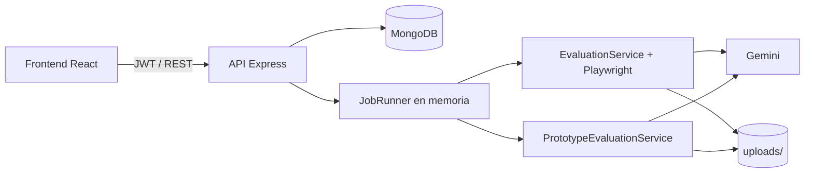
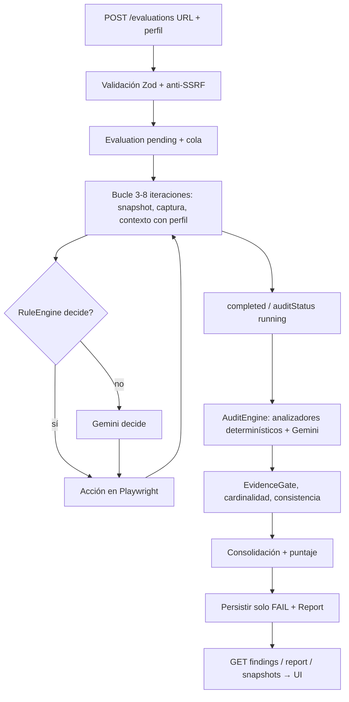
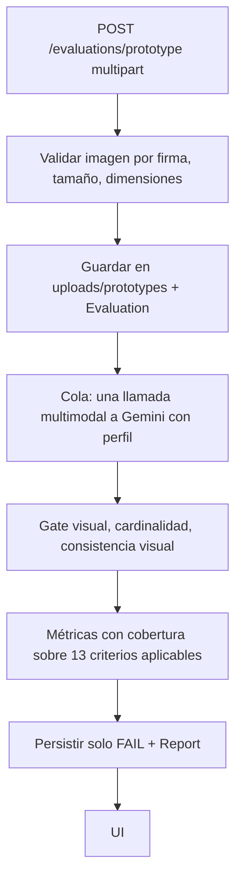

# Análisis de validación metodológica y técnica de EvalUXIA — Fase 3 UNAD

> Documento de trabajo para tomar decisiones. **No contiene texto definitivo** para el documento maestro ni resultados empíricos.
> Fecha del análisis: 2026-10-22. La guía de la Fase 3 indica cierre el **sábado 24 de octubre de 2026**.

**Etiquetas usadas en todo el documento**

| Etiqueta | Significado |
|---|---|
| **[V]** | Verificado por mí en esta sesión (lectura de código/archivo o ejecución de comando). |
| **[I]** | Inferencia razonable a partir de evidencia verificada; no comprobada directamente. |
| **[R]** | Recomendación mía. Es una decisión metodológica, no un requisito documentado. |
| **[P]** | Pendiente: falta información o confirmación. |

---

## 1. Resumen ejecutivo

1. **Qué validar [R].** Tres cosas separadas: (A) funcionamiento técnico de las evaluaciones, (B) calidad de los hallazgos frente a una referencia independiente, (C) utilidad de las recomendaciones valorada por jueces humanos. La usabilidad de la interfaz de EvalUXIA (SUS) es complementaria y opcional.
2. **Enfoque [R].** El **enfoque cuantitativo es defendible** para el objetivo específico 4 tal como está redactado, porque este habla de *ejecución, identificación de hallazgos, generación de resultados, utilidad y pertinencia*, no de la experiencia de uso de la plataforma. La unidad de análisis son **interfaces y criterios**, no personas. Se pierde la explicación cualitativa (Think-Aloud); esa pérdida se puede declarar como limitación.
3. **Lo que la documentación exige y lo que no [V].** La guía escrita de la Fase 3 solo exige las secciones "Muestra y población", "Construcción e implementación del instrumento" y "Análisis y diagnóstico". **No fija 30 personas ni 15 preguntas.** Esas cifras las dijo el tutor oralmente en la webconferencia del 25-sep-2026 (turno que inicia en 16:32 de la transcripción) como regla "transversal": si la población supera 50, aplicar el instrumento a 30 personas; mínimo 15 preguntas, máximo 2 abiertas. El mismo tutor aclaró (turno de 0:05) que se puede pasar de mixto a cuantitativo si no hay variables cualitativas fuertes, y que ese cambio es autónomo y se documenta en la metodología.
4. **Tensión principal [P].** La regla oral del tutor (cuestionario a 30 personas) está pensada para validar la problemática con una población. Mi diseño valida la calidad de las evaluaciones con una referencia independiente. **Hay que confirmar con el tutor, por escrito, si la matriz de validación contra referencia cuenta como "instrumento de medición" o si además espera el cuestionario.** En la sección 11 dejo un diseño de respaldo (cuestionario de 15 ítems) que cumple la regla oral sin renunciar a lo demás.
5. **Hallazgo técnico más importante para la validación [V].** Solo se persisten los hallazgos con estado `FAIL`. Los `PASS` y `NOT_EVALUABLE` solo quedan como conteos en el `Report`. Sin ese dato no se pueden calcular exhaustividad por criterio ni exactitud de los `PASS`. Es un requerimiento nuevo de soporte a la validación (RV-01, sección 15). **No lo implementé.**
6. **El `origin` (determinístico vs. IA) no se persiste** salvo dentro de `discrepancy` [V]. Tampoco hay identificador de regla, y los hallazgos de IA de la modalidad web tienen `iteration: 1` y `screenshotUrl` del paso 1 fijos en código [V].
7. **Evidencia de ejecuciones reales [V/I].** Hay 62 conjuntos de capturas de evaluaciones web en `uploads/` (agosto–octubre 2026) y un archivo de prototipo subido el 2026-10-16. **No pude consultar la base de datos** (MongoDB no estaba levantado y no lo inicié), así que no sé cuántas evaluaciones terminaron bien. Para la modalidad de prototipos, **no hay resultados persistidos** de ninguna ejecución real con Gemini: una prueba existente depende de archivos en `/tmp` de experimentos "P7.1/P7.3" que ya no existen.
8. **Estado del código [V].** Casi todo el trabajo reciente (módulo de prototipos, endurecimiento, fixtures) está **sin commitear** (backend 64 entradas en `git status`, frontend 22). El último commit es del 2026-09-06.
9. **Pruebas ejecutadas hoy [V].** Frontend: 7 archivos, 33 pruebas, todas pasan; `tsc` sin errores. Backend: `tsc --noEmit` sin errores; 74 scripts de prueba ejecutados, 73 con código de salida 0 y 1 fallido por falta del artefacto en `/tmp`. Excluí 17 scripts por riesgo (base de datos, escritura en `uploads/`, Gemini real, E2E).
10. **Corpus controlado ya existente [V].** El backend tiene 17 fixtures HTML y 3 prototipos PNG con `groundtruth.json`, un oráculo (`ground-truth-oracle.ts`) y emparejadores de hallazgos (`finding-matching.ts`, `prototype-finding-matching.ts`). Sirven como evidencia de *funcionamiento* y regresión, **no como evidencia de generalización**: las diseñó el propio desarrollador conociendo el sistema.
11. **Referencia independiente [R].** Combinar: dos evaluadores humanos ciegos con checklist fijo, un verificador automático no basado en IA para el subconjunto objetivo de WCAG, y adjudicación posterior de hallazgos no listados. Calcular las métricas con una referencia estricta y una laxa.
12. **Tamaño [R].** Corpus real de **10 sitios web + 6 prototipos**, más el corpus controlado existente. Es una decisión de viabilidad, no un tamaño estadísticamente universal. Debe declararse como muestreo intencional, con resultados descriptivos.
13. **Participantes humanos [R].** El objetivo central no los necesita como "usuarios", pero sí necesita **2–3 jueces** (referencia y valoración de recomendaciones). SUS con ~5 usuarios y Think-Aloud son opcionales. El tamaño 30 solo si el tutor lo confirma.
14. **Incoherencias a corregir en el documento maestro [V]:** el resumen promete "validación funcional y de usabilidad"; el cronograma incluye SUS y pruebas con usuarios pero no la construcción de la referencia; la lista de referencias tiene citas faltantes y sobrantes; el "Marco tecnológico" está vacío; la guía pide "Diseño preliminar del prototipo" y el documento dice "Diseño de la solución".
15. **No se debe afirmar todavía [P]** que EvalUXIA sea precisa, que sus recomendaciones sean útiles ni que cumpla un nivel de madurez superior. No hay evidencia empírica.

---

## 2. Documentos consultados y limitaciones

### 2.1 Documentos

| Documento | Cómo lo usé | Estado |
|---|---|---|
| Guía de aprendizaje Fase 3 – Formulación del proceso metodológico investigativo (`~/Downloads`) | Estructura y requisitos escritos | Leída completa |
| Documento maestro actual (PDF adjunto, `Guia Metodologica Doc Maestro … (1) (1).pdf`) | Contenido actual, citas, cronograma, recursos | Leído completo. Las secciones en gris son el borrador antiguo |
| F-7-9-1 `… - Isis Rios.pdf` (fecha 21/09/2026, 44 págs.) | Objetivos, metodología mixta, TRL, instrucciones del formato | Leído en secciones relevantes |
| Transcripción de la tercera webconferencia Fase 3 (25-sep-2026) | Orientaciones orales del tutor | Leída por ventanas alrededor de palabras clave (enfoque, muestra, instrumento, 30, 15). **No leí los 55 minutos completos** |
| `RESUMEN EJECUTIVO DE LA WEBCONFERENCIA.pdf` | Corresponde a la **Fase 2**, no a la 3. Solo lo usé para orientaciones generales (20 referencias, antigüedad ≤5 años) | Leído parcialmente |
| `investigación bibliográfica para fundamentar marco metodológico.docx` | Lo convertí a texto pero **no lo analicé en detalle** | No usado como evidencia |
| `INFORME_ESTADO_ARQUITECTURA.md` (15-sep) y `analisis_tecnico_metodologico_evaluxia.md` (12-oct) | Comparación con el código actual | El segundo, leído hasta la sección 3. Contrasté sus afirmaciones con el código |
| `EVALUXIA_MASTER_CONTEXT.md` (Descargas) | Solo su Apéndice A (evidencia experimental `launchpage.xyz`) | Fuente secundaria |
| `Anexo 3 / Anexo 4 – Gestión de proyectos ágiles` (Descargas) | **Pertenecen a otro proyecto (AquaSmart, 2025, otro curso).** No son evidencia de EvalUXIA | Excluidos |
| Anexo 1 Guía de referencias bibliográficas | Solo existencia | No revisado |

**No encontré:** rúbrica de evaluación de la Fase 3, ni una "guía metodológica" distinta del propio documento maestro, ni la versión de F-7-9-1 con la firma de aprobación. Hay ~17 versiones de F-7-9-1 en Descargas y no las comparé. **[P]** Confirmar cuál es la aprobada.

### 2.2 Comandos ejecutados y resultados [V]

| Comando | Resultado |
|---|---|
| Frontend `npx vitest run` | 7 archivos, 33 pruebas, todas pasan |
| Frontend `npx tsc -b --noEmit` | Sin errores |
| Backend `npx tsc --noEmit` | Sin errores reportados |
| Backend, 74 scripts `*.test.ts` con `ts-node` (límite 90 s cada uno) | 73 con código 0. 1 falla: `p7-criterion-matching-regression.test.ts`, porque exige `/tmp/prototype-p7-experiment-2-result.json`, que no existe |
| Consulta de conteos en MongoDB (solo lectura) | **No ejecutada con éxito**: `ECONNREFUSED 127.0.0.1:27017` |

**No ejecuté:** 17 scripts excluidos por riesgo, ninguna llamada a Gemini, ninguna evaluación real, ni el sistema completo. Verifiqué que `uploads/` y `git status` no cambiaron tras las pruebas (208 archivos antes y después; 64 entradas).

Diferencia con el análisis del 12-oct: entonces había 20 pruebas en el frontend y 86 archivos de prueba en el backend; hoy hay 33 y 91.

---

## 3. Estado técnico verificado de EvalUXIA

### 3.1 Repositorios

| Repo | Ruta | Commits | Estado |
|---|---|---|---|
| Frontend | `/Users/isisrios/Proyectos/React/evaluxia` | 10 (último 2026-09-06) | 11 modificados + 11 sin trackear |
| Backend | `/Users/isisrios/Proyectos/Node/evaluxia_backend` | 12 (último 2026-09-06) | 64 entradas (módulo de prototipos, servicios de evidencia, `fixtures/`, `shared/testing/`, pruebas) |

### 3.2 Endpoints verificados (`src/app/app.ts` y `*.routes.ts`)

Todos bajo `/api/v1`, protegidos por JWT salvo registro/login/refresh:

- `auth`: `POST /register`, `/login`, `/refresh`, `/logout`, `GET /me`.
- `evaluator-profiles`: CRUD + `PATCH /:id/activate`.
- `evaluations`: `GET /`, `POST /` (sitio web), `POST /prototype` (multipart), `GET/PATCH/DELETE /:id`.
- `findings`: CRUD y `GET /evaluation/:evaluationId`. `reports`: `GET /evaluation/:evaluationId`, `GET /metrics/cumulative`. `snapshots`: `GET /evaluation/:evaluationId`.
- `automation` (`/navigate`, `/snapshot`, `/screenshot`) y `ai`: endpoints auxiliares/de desarrollo, también autenticados.
- `GET /health` público.

**No hay endpoint de exportación** de evaluaciones para análisis. Se puede recuperar la información por los endpoints anteriores o con un script de solo lectura contra MongoDB.

### 3.3 Modalidad URL — flujo real [V]

Archivos: `evaluation.service.ts`, `automation.service.ts`, `rule-engine.service.ts`, `dynamic-iterations.service.ts`, `audit-engine.service.ts`, `deterministic-analyzer.service.ts`, `evidence-gate.service.ts`.

1. `POST /evaluations` valida con Zod y `assertSafeUrl` (anti-SSRF, `url-guard.ts`), comprueba que el perfil pertenece al usuario, crea la `Evaluation` en `pending` y encola en `jobRunner` (en memoria, `setImmediate`).
2. Fase 1 (exploración): sesión Playwright/Chromium headless (viewport 1280×720). Bucle de **3 a 8 iteraciones** (`calculateDynamicMaxIterations`, mín. 3, máx. 8). En cada iteración: snapshot del DOM → captura PNG → `SnapshotEvidence` → contexto mínimo (`context-builder`, incluye el perfil) → `RuleEngine` (5 reglas determinísticas, más la regla 0 de parada ante fallo/repetición) → si no decide, **Gemini** (`aiService.makeDecision`) → ejecución de la acción. Acciones soportadas: `CLICK, TYPE, SELECT, CHECK, UNCHECK, HOVER, FOCUS, CLEAR, NAVIGATE, STOP_FLOW`.
3. Fase 1 **no persiste hallazgos**. Termina con `status: completed` y `auditStatus: running`.
4. Fase 2 (`AuditEngine.performAudit`, asíncrona): `DeterministicAnalyzer` (6 analizadores) + Gemini sobre evidencia deduplicada/priorizada → `EvidenceGate` (trazabilidad selector→evidencia, coherencia de afirmaciones, lenguaje especulativo) → cardinalidad "1 hallazgo = 1 criterio WCAG" → consolidación (`AuditMetricsService`) → **solo los `FAIL` se persisten** como `Finding` → `Report` con métricas → `auditStatus: completed`.
5. Si Fase 1 falla: `status`/`auditStatus: failed` y `flowState.blockingError` con prefijo `[AI_PROVIDER_ERROR n]` o `[EVALUATION_ERROR n]`.
6. Una exploración puede **detenerse antes de tiempo y aun así quedar `completed`** (regla 0 por acción fallida o repetida). El frontend lo muestra con `IncompleteExplorationNotice` leyendo `flowState.blockingError`.

**Universo de criterios web: 20** (10 Nielsen N-01…N-10 + 10 WCAG: 1.1.1, 1.3.1, 1.4.1, 1.4.3, 2.1.1, 2.4.4, 2.4.6, 3.2.2, 3.3.2, 4.1.2; `SUPPORTED_*` en `audit-metrics.service.ts`). El prompt de IA cubre 8 criterios WCAG; según comentarios de `ai.service.ts` (~L612-640), 2.1.1 y 3.2.2 no son evaluables por la IA.
**Analizadores determinísticos:** contraste 1.4.3, imágenes 1.1.1, botones 4.1.2, enlaces 2.4.4, encabezados 1.3.1/N-04, formularios 3.3.2.
**Puntaje:** `overallScore = round(baseQuality × gammaCoverage)`, calculado en backend; el puntaje de Gemini se ignora (`audit-metrics.service.ts` ~L597-615).

### 3.4 Modalidad imagen — flujo real [V]

Archivos: `evaluation.routes.ts`, `prototype-upload.middleware.ts`, `prototype-image-upload.service.ts`, `prototype-evaluation.service.ts`, `prototype-criteria-resolver.ts`, `visual-evidence-gate.service.ts`, `visual-evidence-consistency.service.ts`, `prototype-metrics.service.ts`, `ai/contracts/prototype.contracts.ts`.

1. `POST /evaluations/prototype`: multipart, **una imagen** PNG/JPEG/WebP (detección por firma binaria), ≤10 MB, ≤8000 px por lado, más `evaluatorProfileId`, título y descripción (≥10 caracteres).
2. Se guarda en `uploads/prototypes/<uuid>.<ext>`; se crea la `Evaluation` (`type: 'prototype'`, `imageUrl`) y se encola el job.
3. **No hay exploración ni Playwright.** Una sola llamada multimodal a Gemini (`performPrototypeAuditAnalysis`) con imagen, descripción y perfil (incluye `techSavviness`, `accessibilityNeeds`, `preferredDevice` y biografía truncada a 400 caracteres).
4. Validaciones: Gate visual → cardinalidad → consistencia de evidencia visual. Evidencia solo de tipo `VISUAL_OBSERVATION` con regiones (rejilla 3×3 + `full-screen`) y descripción del elemento.
5. **19 criterios definidos; 13 aplicables** (7 WCAG + 6 Nielsen) y **6 fuera de cobertura** declarada (WCAG 4.1.2, 2.1.1; N-01, N-07, N-09, N-10). El contraste 1.4.3 es solo observación visual: la IA tiene prohibido calcular una razón numérica. Métricas locales (`prototype-metrics.service.ts`) con cobertura sobre criterios aplicables.
6. Se persisten solo los `FAIL`, con `iteration: 1`. El campo `affectedArchetypeTraits` del contrato **no se persiste** (no existe en el modelo `Finding`).

### 3.5 Qué se almacena realmente

| Dato | ¿Existe? | Dónde |
|---|---|---|
| Modalidad, URL/imagen, perfil usado, estados | Sí | `Evaluation` (`type`, `url`, `imageUrl`, `evaluatorProfileId`, `status`, `auditStatus`, `createdAt/updatedAt`) |
| Pasos de exploración, error bloqueante | Sí (web) | `Evaluation.flowState` |
| Hallazgos `FAIL` con categoría (`findingGroup`), severidad, confianza, criterio (`wcagCriterion`/`heuristicCode`), descripción, evidencia, elemento afectado, impacto, recomendación (opcional) | Sí | `Finding` |
| Hallazgos `PASS` / `NOT_EVALUABLE` individuales | **No** | Solo conteos en `Report` |
| Origen determinístico/IA | **No** (solo en `discrepancy.origin`) | — |
| Identificador de regla/analizador | **No** | El criterio funciona como traza aproximada |
| Conteos por severidad y estado, cumplimiento Nielsen/WCAG, cobertura, `overallScore`, `coverage` (prototipo) | Sí | `Report` |
| Tokens, costo estimado, modelo, nº de llamadas, `totalExecutionTimeMs` | Sí | `Report.metrics` (`MetricsTracker`) |
| Capturas por iteración y evidencia estructurada | Sí (web) | `uploads/` y `SnapshotEvidence` |

**Notas sobre tiempo [V/I].** `totalExecutionTimeMs` suma solo el tiempo de las llamadas a Gemini (`aiCall.executionTimeMs`), no el de Playwright. El tiempo total real se puede aproximar con `updatedAt − createdAt` de la `Evaluation` **[I]** (el último `update` marca `auditStatus: completed`), pero no es un campo propio.

### 3.6 Perfiles evaluadores [V]

- Modelo `EvaluatorProfile`: nombre, frase, edad, profesión, estado civil, país, ciudad, arquetipo, biografía, personalidad, metas, frustraciones, `techSavviness`, `accessibilityNeeds[]`, `preferredDevice`, `isActive`.
- **Web:** el perfil entra al prompt de decisión (incluye personalidad, metas, frustraciones) y al prompt de auditoría (solo nombre, arquetipo, profesión, frase, metas y frustraciones: **no** `techSavviness` ni `accessibilityNeeds`).
- **Prototipo:** el prompt incluye también `techSavviness`, `accessibilityNeeds`, `preferredDevice` y biografía. Hay una **asimetría** entre modalidades.
- `DeterministicAnalyzer.analyzeSnapshots(evidences)` **no recibe el perfil** → los hallazgos determinísticos son independientes del perfil. El perfil solo puede influir en la parte de IA y, en web, en el recorrido de exploración.

### 3.7 Determinismo y dependencias externas

| Comportamiento | Naturaleza |
|---|---|
| Analizadores determinísticos, `RuleEngine`, consolidación, puntaje, gates, cardinalidad | Determinista **dado el mismo snapshot** |
| Snapshot/DOM | Puede variar entre ejecuciones (contenido dinámico, anuncios, tiempos de carga) **[I]** |
| Decisiones de exploración y hallazgos de IA | **Variable**: no encontré configuración explícita de `temperature` ni `seed` en `gemini.client.ts` **[V]** (solo `responseMimeType: 'application/json'`) |
| Modelo | `GEMINI_MODEL` por defecto `gemini-2.5-flash` (`env.ts`). **`docker-compose.yml` usa `gemini-2.0-flash` por defecto**: inconsistencia a resolver y a registrar en cada ejecución |
| Cola de trabajos | En memoria; no sobrevive a un reinicio |

### 3.8 Pruebas: software vs. calidad de resultados

| Tipo | Qué verifican | Ejemplos |
|---|---|---|
| Pruebas de software con mocks | Contratos Zod, gates, deduplicación, métricas, subida de imagen, resiliencia ante errores de Gemini, SSRF, propiedad de recursos | `audit-metrics.test.ts`, `url-guard.test.ts`, `gemini-resilience.test.ts`, `prototype-contracts.test.ts` |
| Pruebas con ground truth sintético | Que el oráculo y los emparejadores clasifican bien; que los analizadores determinísticos detectan defectos sembrados | `ground-truth-oracle.test.ts`, `finding-matching.test.ts`, `deterministic-analyzer-forms.test.ts`, `p7-contact-form-ground-truth.test.ts` |
| Runners con Gemini real (protegidos por variables `*_AUTHORIZED=yes`) | Medir comportamiento real de Gemini sobre fixtures | `landing-v1-real-gemini-run.ts`, `prototype-p7-real-gemini-run(-2).ts`, `h-real-controlled-runner.ts` |
| E2E contra MongoDB/Playwright | Flujo completo | `run_e2e_validation_3d/3e/3f.ts`, `run_e2e_launchpage_test.ts` |
| Frontend | Componentes y hook de evaluaciones con mocks | 7 archivos / 33 pruebas |

**Importante:** `npm test` en el backend ejecuta **solo** `contracts.test.ts`. Las pruebas pasan por convención de scripts (código de salida), sin framework.
**Ninguna prueba demuestra que los hallazgos reales sean correctos.** El corpus de ground truth sí permite medirlo, pero los resultados de los experimentos reales no están persistidos (los runners escriben en `/tmp`, y esos archivos ya no existen).

### 3.9 Evidencia de ejecuciones reales

| Afirmación | Evidencia | Valor |
|---|---|---|
| Se ejecutaron evaluaciones web reales | 62 identificadores distintos de evaluación en `uploads/` (fechas 2026-08-02 a 2026-10-16); Apéndice A de `EVALUXIA_MASTER_CONTEXT.md` documenta `launchpage.xyz` (7 iteraciones, 5 hallazgos, puntaje 24) | [V] capturas / [I] que terminaron; BD inaccesible |
| Se ejecutó al menos una evaluación de prototipo | 1 archivo en `uploads/prototypes/` creado el 2026-10-16 | [I]; no sé si completó |
| Se ejecutaron experimentos reales de Gemini sobre prototipos (P7.1/P7.3) | El test `p7-criterion-matching-regression` los menciona como "ya ejecutados"; **sus artefactos no existen** | [I]; sin evidencia persistida |
| Las 3 cifras de F-7-9-1 sobre "ejecuciones de extremo a extremo sobre sitios web públicos" | Compatible con lo anterior | [P] confirmar con BD |

---

## 4. Aspectos que deben validarse

### A. Funcionamiento técnico de las evaluaciones

- **Qué comprobar:** que cada evaluación llega a `completed/completed`, con qué frecuencia la exploración se trunca, cuánto tarda y cuánto cuesta.
- **Por qué importa:** es el primer eslabón del objetivo específico 4 ("verificar la ejecución de las evaluaciones").
- **Evidencia:** estados, `flowState.blockingError`, `Report.metrics`, tiempos.
- **Datos existentes:** todos los anteriores [V]. **Adicionales:** registro de cada ejecución del protocolo (incluidas las fallidas) y fecha/modelo.
- **Conclusiones válidas:** tasa de finalización y tiempos *en el corpus evaluado*. **No válidas:** fiabilidad general en producción ni sobre sitios con CAPTCHA/autenticación (fuera del alcance declarado).

### B. Calidad de los hallazgos

- **Qué comprobar:** qué proporción de los `FAIL` emitidos se confirma con una referencia independiente (precisión), qué proporción de los problemas de referencia se detecta (exhaustividad) y si el sistema se abstiene o inventa ante evidencia insuficiente.
- **Por qué importa:** es el núcleo del problema ("identificar problemas reales o justificables").
- **Evidencia:** matriz de referencia + comparación (sección 8).
- **Datos existentes:** `Finding` con criterio, severidad, evidencia, elemento. **Faltan:** `PASS`/`NOT_EVALUABLE` por criterio y el `origin`. Requieren RV-01 o un volcado en modo investigación.
- **Válido concluir:** precisión y exhaustividad *descriptivas* en el corpus, por modalidad y por criterio. **No válido:** "EvalUXIA detecta X % de los problemas de UX" en general; la referencia es un subconjunto acordado por evaluadores, no la verdad absoluta.

### C. Utilidad y pertinencia de las recomendaciones

- **Qué comprobar:** si cada recomendación es pertinente al hallazgo, técnicamente correcta, clara y aplicable.
- **Por qué importa:** el resumen y el objetivo específico 4 hablan de "utilidad y pertinencia".
- **Evidencia:** valoración humana con rúbrica (sección 8.3). **No se puede sustituir por una métrica automática**: la corrección técnica de una recomendación y su aplicabilidad requieren juicio de un especialista; una frase bien redactada puede ser técnicamente errónea.
- **Datos existentes:** `Finding.recommendation` (opcional; la proporción con recomendación sí es medible).
- **Válido concluir:** distribución de valoraciones por jueces. **No válido:** que los usuarios reales aplicarían las recomendaciones ni que mejoren la interfaz (no se mide el efecto).

### D. URL vs. imagen

- **Qué comprobar:** diferencias en cobertura, abstención, precisión y exhaustividad entre modalidades.
- **Por qué importa:** las modalidades no son equivalentes: la imagen tiene 13 criterios aplicables y declara 6 fuera de cobertura; la URL tiene 20 y evidencia programática (DOM, árbol de accesibilidad, estilos computados).
- **Cuidado:** comparar solo sobre el **subconjunto común de criterios** (p. ej. N-02…N-06, N-08, 1.4.1, 2.4.6; 1.1.1/1.3.1/3.3.2/2.4.4/1.4.3 con las salvedades de "parcialmente evaluable"). Los puntajes globales **no son comparables** (denominadores distintos).

### E. Influencia de los perfiles

- **Qué comprobar:** si cambiar de perfil cambia los hallazgos o su redacción más allá de la variabilidad normal entre ejecuciones de la IA.
- **Condiciones [V]:** perfiles configurables existen; el perfil influye solo en la IA; no se persisten los rasgos de perfil por hallazgo.
- **Diseño mínimo [R]:** 2 perfiles contrastantes (p. ej. `techSavviness` bajo con necesidades de accesibilidad vs. alto sin ellas) × 3 repeticiones × 2–3 interfaces (preferible prototipos: más baratos y sin exploración variable). Comparar la diferencia **entre perfiles** con la diferencia **entre repeticiones del mismo perfil**.
- **Válido concluir:** si hay o no diferencias *mayores que el ruido*. **No válido:** que el perfil represente a usuarios reales (el propio documento maestro lo descarta).
- **Prioridad baja:** incluir solo si hay tiempo.

### F. Usabilidad de la propia plataforma (complementaria)

- **¿Merece la pena?** Solo si el tutor exige usuarios o si se quiere sostener la promesa "validación funcional y de usabilidad" del resumen. No es necesaria para el objetivo específico 4 tal como está redactado.
- **Instrumento mínimo:** SUS (10 ítems) tras 3–4 tareas (iniciar sesión, elegir perfil, evaluar una URL, leer el informe), n≈5 usuarios del público objetivo.
- **Válido concluir:** puntaje SUS descriptivo y tareas completadas. **No válido:** generalizar con n=5, ni inferir calidad de los hallazgos.

---

## 5. Indicadores candidatos y viabilidad

Tipos de obtención: **D** = directo con datos existentes; **I** = requiere instrumentar/registrar; **R** = requiere referencia independiente; **H** = requiere participantes humanos; **N** = no medible razonablemente.

| Aspecto | Indicador | Definición operacional | Fórmula / método | Datos necesarios | Fuente | Viabilidad actual | Limitaciones |
|---|---|---|---|---|---|---|---|
| A | I-A1 Tasa de finalización | Ejecuciones del protocolo que terminan `status=completed` y `auditStatus=completed` | `completadas / ejecuciones totales` (todas las ejecuciones, incluidas fallidas) | Estados por ejecución | `Evaluation` | **D** | Una exploración truncada también cuenta como completada |
| A | I-A2 Tasa de exploración completa | Web completadas sin `blockingError` | `completadas sin blockingError / completadas` | `flowState.blockingError` | `Evaluation` | **D** (solo web) | El criterio de "completa" es el del sistema (iteraciones máx. 3–8) |
| A | I-A3 Tiempo de ejecución | Tiempo de pared y tiempo de IA | `updatedAt − createdAt`; `metrics.totalExecutionTimeMs` | Marcas de tiempo | `Evaluation`, `Report` | **D** parcial | El primero es una aproximación [I]; el segundo excluye Playwright |
| A | I-A4 Costo y tokens | Tokens y costo estimado por evaluación | `metrics.estimatedCostUsd`, `totalTokens` | — | `Report.metrics` | **D** | Costo excluye *thinking tokens* si no hay tarifa verificada (`costStatus`) |
| A | I-A5 Variabilidad entre ejecuciones | Estabilidad del conjunto de `FAIL` ante repeticiones de la misma interfaz | Índice de Jaccard medio entre pares de ejecuciones sobre pares (criterio, elemento); rango del nº de `FAIL` | k=3 ejecuciones por interfaz (subconjunto) | `Finding` | **D** tras repetir | Sin `PASS` persistidos solo se compara el conjunto de `FAIL`. Costo de IA ×k |
| B | I-B1 Precisión de `FAIL` (estricta/laxa) | Proporción de `FAIL` emitidos confirmados | Estricta: `TP / (TP+FP)`; laxa: `(TP+J) / emitidos`, con J = "justificable no listado" | Adjudicación por interfaz | Matriz de comparación | **R + I** | Depende de la calidad de la referencia |
| B | I-B2 Exhaustividad de `FAIL` | Problemas de referencia detectados | `TP / (TP+FN)`, solo sobre criterios aplicables a la modalidad | Referencia por criterio | Matriz | **R** | Referencia incompleta por construcción; reportar con referencia estricta y laxa |
| B | I-B3 Falsos positivos sobre controles negativos | `FAIL` emitidos donde ambos jueces marcaron PASS | `FP_ctrl / controles evaluados` | Controles negativos en el corpus | Matriz | **R** | Exige incluir interfaces o elementos bien resueltos |
| B | I-B4 Cobertura y abstención | Criterios evaluados vs. `NOT_EVALUABLE` | `auditCoverage` (web); `coverage.evaluatedCriteria / applicableCriteria` (prototipo) | — | `Report` | **D** | Abstenerse no es acertar: se reporta aparte, no se mezcla en precisión |
| B | I-B5 Respaldo de evidencia | `FAIL` con ≥1 elemento de evidencia; verificación manual en muestra de que esa evidencia respalda la afirmación | `FAIL con evidence.length>0 / FAIL`; revisión manual de n hallazgos | `Finding.evidence` | `Finding` + revisión | **D** (parte 1) / **H** (parte 2) | Presencia de evidencia ≠ evidencia correcta |
| B | I-B6 Concordancia entre evaluadores de referencia | Acuerdo sobre PASS/FAIL por criterio | % de acuerdo y kappa de Cohen (descriptivo) | Dos matrices ciegas | Matriz | **H** | Con pocos casos, kappa es inestable; presentar junto al % de acuerdo |
| C | I-C0 Completitud de recomendación | `FAIL` con recomendación no vacía | `con recomendación / FAIL` | — | `Finding.recommendation` | **D** | Presencia ≠ calidad |
| C | I-C1…C4 Pertinencia, corrección técnica, claridad, aplicabilidad | Puntuación ordinal 0–2 por dimensión | Distribución, mediana y % con puntuación 2 | Valoraciones de 2 jueces sobre los `FAIL` confirmados (o muestra) | Rúbrica | **H** | Juicio humano; sin efecto real sobre usuarios |
| D | I-D1 Comparación entre modalidades | P, R y abstención por modalidad sobre criterios comunes | Mismas fórmulas, restringidas al subconjunto común | Resultados de B | Matriz | **R** | Corpus pequeño; no hay inferencia estadística |
| E | I-E1 Efecto del perfil | Solapamiento de `FAIL` entre perfiles vs. entre repeticiones | Jaccard entre perfiles / Jaccard intra-perfil | 2 perfiles × 3 repeticiones | `Finding` | **D** tras ejecutar | Opcional; rasgos de perfil no se persisten por hallazgo |
| F | I-F1 SUS | Puntaje 0–100 del cuestionario SUS | Procedimiento estándar (Brooke, 1996) | Respuestas de ~5 usuarios | Formulario externo | **H** | n muy pequeño; no describe calidad de hallazgos |
| — | F1 global | No propongo F1 como indicador principal | — | — | — | **N** hoy | Solo tendría sentido tras definir TP/FP/FN con la referencia (abajo) |
| — | Precisión sobre problemas "reales" en absoluto | — | — | — | — | **N** | No existe verdad absoluta en UX |
| — | Efecto sobre usuarios reales de seguir las recomendaciones | — | — | — | — | **N** | Excede el alcance |

**Descartados a propósito [R]:** cantidad de hallazgos como medida de calidad (más hallazgos no es mejor), exactitud global (accuracy) por dominarla los `PASS`, y concordancia por severidad (escala demasiado subjetiva para el tamaño del estudio).

### Definición de TP, FP y FN (unidad: interfaz × criterio × elemento)

- **Referencia:** conjunto de problemas (criterio + elemento) que los dos jueces ciegos marcan `FAIL`, con tres niveles: *acordado* (ambos), *en disputa* (uno solo), *sin acuerdo de descarte*.
- **TP:** hallazgo `FAIL` de EvalUXIA que corresponde a un problema de referencia acordado (mismo criterio y mismo elemento o región).
- **FP:** hallazgo `FAIL` que ambos jueces, al ver la interfaz, **no** pueden justificar. Los hallazgos que los jueces consideran válidos aunque no estaban en la referencia se clasifican aparte como **J = justificable no listado** (ni TP ni FP en la referencia laxa).
- **FN:** problema de referencia acordado sin ningún `FAIL` correspondiente. Se subdivide en *abstención* (`NOT_EVALUABLE`) y *omisión silenciosa* (sin mención o `PASS` erróneo); esa subdivisión exige RV-01.
- **Referencia estricta:** solo problemas acordados. **Referencia laxa:** acordados + en disputa. Se informan ambas.
- **Prototipos:** los criterios `OUT_OF_COVERAGE` se **excluyen** del denominador de exhaustividad: el propio sistema los declara no evaluables.

---

## 6. Comparación de enfoques cuantitativo y mixto

| Criterio | Cuantitativo | Mixto (F-7-9-1 §9.1) |
|---|---|---|
| Objetivo general | Compatible: "realizar evaluaciones automáticas" se comprueba con funcionamiento y calidad medibles | Compatible, pero el componente cualitativo (Think-Aloud) apunta a la experiencia de usar la plataforma, que el objetivo no persigue |
| Objetivo específico 4 | Se responde con indicadores de ejecución, concordancia con la referencia y valoración de utilidad | Exige además observar usuarios; el texto del objetivo no lo pide |
| Variables | Estado de ejecución, tiempos, costos, TP/FP/FN, escala ordinal de recomendaciones, SUS (opcional) | Las anteriores + verbalizaciones y problemas de interacción de los usuarios |
| Instrumentos | Matriz de comparación, rúbrica, SUS opcional | Matriz, rúbrica, SUS, protocolo Think-Aloud, registro de observación |
| Análisis | Estadística descriptiva (frecuencias, porcentajes, medianas, intervalos) | Descriptiva + análisis temático de verbalizaciones + triangulación |
| Tiempo y recursos | Menor: 2–3 jueces y corpus de ~16 interfaces | Mayor: reclutar, observar y transcribir sesiones |
| Requisito de la Fase 3 | El tutor lo avala si no hay variables cualitativas fuertes | Sin objeción, pero implica más trabajo para el diagnóstico |

**Qué se excluye al ser cuantitativo [V/R]:** el protocolo Think-Aloud y el análisis de verbalizaciones. **Qué información se pierde:** las *causas* por las que un usuario se confunde al usar la plataforma y los comentarios espontáneos sobre la utilidad de los informes. **Mitigación [R]:** dos preguntas abiertas opcionales en el cuestionario (el tutor permite hasta 2) y un análisis de errores caso a caso por la investigadora (por qué fue FP o FN), que es parte del diagnóstico y no constituye un enfoque cualitativo.

**Consecuencias académicas de modificar lo aprobado [V/R]:**
- F-7-9-1 §9.1, el resumen ("validación funcional y de usabilidad") y el cronograma (SUS, pruebas con usuarios) deben reescribirse de forma coherente.
- Los objetivos **no cambian**; el tutor advirtió que modificar objetivos es un cambio estructural (turno de 0:05).
- Debe quedar un registro del cambio y su justificación en la metodología. **[P]** Pedir confirmación escrita al tutor.

---

## 7. Recomendación metodológica fundamentada

1. **Enfoque cuantitativo, investigación aplicada, diseño no experimental descriptivo-comparativo** (evaluación del desempeño de una herramienta frente a una referencia independiente). **[R]**
2. **Núcleo:** validación técnica (A), calidad de hallazgos (B) y valoración de recomendaciones por jueces (C), sobre dos corpus: controlado (existente) y real (nuevo).
3. **Complementos opcionales:** D (comparación entre modalidades) como producto natural de B; E (perfiles) solo si hay tiempo; F (SUS con ~5 usuarios) solo si el tutor lo exige o si se quiere mantener la promesa de "usabilidad" del resumen.
4. **Por qué no mixto:** el componente cualitativo no es central para el objetivo general ni para el específico 4 tal como están redactados. Si el tutor exige participantes, SUS cumple como instrumento cuantitativo y no obliga a Think-Aloud.
5. **Cambios necesarios en el documento maestro:** reescribir la metodología de investigación; reemplazar en el cronograma las actividades de "pruebas de usabilidad con usuarios" por las de construcción de referencia, ejecución, comparación y valoración (conservar SUS solo si se mantiene); ajustar el resumen; añadir indicadores al apartado de resultados esperados; redefinir "Muestra y población" (sección 10).
6. **Cualificación:** los resultados serán descriptivos y no generalizables. Lo declaro como limitación, no se oculta.

---

## 8. Diseño del instrumento

Un libro de cálculo con cuatro hojas (más una opcional). Los campos marcados *(sistema)* se pueden volcar de la API/BD; los marcados *(manual)* los registra el equipo.

### 8.1 Hoja `Casos` (una fila por interfaz)

| Campo | Fuente |
|---|---|
| `id_caso` (p. ej. W01, P03), `modalidad` (URL/imagen), `corpus` (A controlado / B real) | manual |
| `url` o `archivo_imagen`, `fecha_captura`, `viewport` | manual / sistema |
| `tipo_interfaz` (landing, formulario, comercio, contenido, panel), `rasgos_relevantes` (modales, contenido dinámico, formularios, íconos sin texto) | manual |
| `problemas_sembrados` (solo corpus A) | `groundtruth.json` |
| `motivo_de_inclusión`, `exclusiones_aplicadas` | manual |

### 8.2 Hoja `Ejecuciones` (una fila por ejecución, **incluidas las fallidas**)

`id_ejecucion`, `id_caso`, `repetición` (1..k), `evaluationId`, `perfil_id`, `modelo` (`Report.metrics.modelUsed`), `commit_front/back`, `estado`, `auditStatus`, `blockingError`, `t_pared_s`, `t_IA_ms`, `tokens`, `costo_usd`, `nº_iteraciones` (web), `incidencias` *(todo sistema salvo commit/incidencias, manual)*.

### 8.3 Hoja `Referencia` (una fila por caso × criterio aplicable × juez)

`id_caso`, `criterio` (de la lista de 20 web o 13 prototipo), `juez` (A/B), `veredicto` (PASS / FAIL / No aplicable), `elemento_o_región`, `severidad_juez`, `nota`. *(manual, ciego respecto a la salida de EvalUXIA)*. Derivadas: `acuerdo`, `estado_referencia` (acordado / en disputa).

### 8.4 Hoja `Comparación` (una fila por hallazgo `FAIL` de EvalUXIA y una por problema de referencia sin hallazgo)

`id_ejecucion`, `findingId` *(sistema)*, `criterio`, `severidad_sistema`, `confianza`, `evidencia (resumen)`, `recomendación` *(sistema)*; `correspondencia` (id del problema de referencia), `clasificación` (TP / FP / J / FN-abstención / FN-omisión), `observación metodológica` *(manual)*.

### 8.5 Hoja `Recomendaciones` (rúbrica, una fila por hallazgo TP o J valorado y por juez)

| Dimensión | 0 | 1 | 2 |
|---|---|---|---|
| Pertinencia | No corresponde al problema | Corresponde en parte o es genérica | Corresponde al problema y al elemento |
| Corrección técnica | Es errónea o empeora la situación | Parcialmente correcta o incompleta | Corrige el problema sin introducir otro |
| Claridad | No se entiende | Se entiende con esfuerzo | Se entiende de inmediato |
| Aplicabilidad | No indica qué hacer | Indica una dirección sin concretar | Indica un cambio concreto que un diseñador/desarrollador puede ejecutar |

Escala de 3 niveles con anclas explícitas para mejorar el acuerdo entre jueces con pocos casos. Análisis: frecuencias, mediana y % con 2 por dimensión; acuerdo entre jueces como % exacto y kappa ponderado de forma descriptiva.

### 8.6 Hoja opcional `SUS`

Diez ítems estándar, una fila por participante, puntaje 0–100. Solo si se mantiene F.

### 8.7 Cuestionario de respaldo (solo si el tutor lo exige)

15 ítems: 10 de SUS + 3 cerrados sobre utilidad/pertinencia de un **informe de muestra** generado por EvalUXIA + 2 abiertos. Ver sección 11.

### 8.8 Qué datos no existen hoy y qué hacer

| Dato | Estado | Opción |
|---|---|---|
| `PASS` y `NOT_EVALUABLE` por criterio | No persistidos | **RV-01:** persistirlos o volcar `consolidatedFindings` en modo investigación. Sin esto, no se separa abstención de omisión silenciosa ni se mide exactitud de PASS |
| `origin` determinístico/IA | No persistido | **RV-02:** añadir campo o inferirlo por criterio (6 criterios determinísticos) **[I]** |
| Tiempo de pared | Aproximable | Registrar `t_pared` en la hoja `Ejecuciones` |
| Rasgos de perfil que motivaron un hallazgo | No persistidos | Solo relevante para E; analizar a mano |

---

## 9. Procedimiento de investigación

| # | Paso | Estado con el sistema actual |
|---|---|---|
| 1 | Seleccionar interfaces (sección 10) y registrar en `Casos` | **Ejecutable ya** |
| 2 | Fijar las listas de criterios: 20 web / 13 prototipo, con definiciones tomadas de Nielsen y W3C, **no del prompt de EvalUXIA** | **Ejecutable ya** |
| 3 | Construir la referencia independiente (juez A, juez B ciegos; verificador automático externo para el subconjunto objetivo; consenso) **antes** de ejecutar EvalUXIA | **Ejecutable ya** (requiere reclutar un juez B) |
| 4 | Ejecutar EvalUXIA en ambas modalidades con **protocolo fijo**: mismo perfil base, mismo modelo, mismo commit; k=3 repeticiones en un subconjunto para medir variabilidad | **Ejecutable ya**; costo de IA y tiempo a estimar |
| 5 | Registrar resultados en `Ejecuciones` mediante endpoints o script de solo lectura | **Requiere preparación** (script de volcado) |
| 6 | Clasificar y comparar hallazgos (TP/FP/J/FN) | **Ejecutable ya** con la salida actual; la separación de FN requiere RV-01 |
| 7 | Valorar recomendaciones con la rúbrica | **Ejecutable ya** |
| 8 | Calcular indicadores | **Ejecutable ya** con hoja de cálculo |
| 9 | Elaborar tablas y gráficos (sección 12) | **Ejecutable ya** |
| 10 | Diagnóstico y limitaciones: análisis de errores caso a caso | **Ejecutable ya** |
| 11 | Identificar mejoras para la plataforma a partir de FP/FN | **Ejecutable ya** |

**Comparabilidad entre ejecuciones [R]:** fijar `GEMINI_MODEL` y registrarlo; resolver la inconsistencia de modelo entre `env.ts` y `docker-compose.yml` antes de empezar; mismo viewport (constante `BROWSER_CONFIG`); mismas fechas de captura en lo posible; guardar una captura y el DOM de cada interfaz el día de la evaluación porque los sitios cambian.
**Fallos técnicos y resultados incompletos [R]:** toda ejecución se registra, también las fallidas. Se permite **una** repetición solo ante fallos de infraestructura (red, 429/503); los fallos de contenido (exploración truncada, hallazgos vacíos) **cuentan** como resultado. Nunca se descartan en silencio.
**Límite de contaminación [R]:** las interfaces usadas durante el desarrollo (fixtures, `launchpage.xyz`, prototipos P7) quedan en el corpus A y **no** se reutilizan como evidencia de generalización.

---

## 10. Selección de interfaces y referencia independiente

### 10.1 Unidades

- **Interfaz:** unidad de muestreo. **Decisión (interfaz × criterio):** unidad de cálculo de P/R. **Juez:** unidad humana. No son equivalentes: 16 interfaces generan ~200 decisiones web y ~80 de prototipo, pero siguen siendo 16 interfaces.

### 10.2 Corpus y tamaño [R]

| Corpus | Contenido | Uso |
|---|---|---|
| **A – controlado (existe)** | 17 HTML + 3 PNG con `groundtruth.json` (31 criterios y 32 hallazgos esperados, incluidos 19 controles negativos) | Evidencia de funcionamiento y regresión; capacidad del sistema ante defectos conocidos. **No** se usa para generalizar |
| **B – real (nuevo)** | **10 sitios web públicos + 6 prototipos visuales** | Calidad de hallazgos y recomendaciones |

**Por qué 10 + 6 [R]:** es un compromiso entre costo de construir la referencia (estimación mía, no medida: del orden de 1–2 h por interfaz por juez), costo de IA y poder describir patrones por tipo de interfaz y por criterio. **Límites:** con ~40 `FAIL` emitidos, una precisión observada de 32/40 tendría un intervalo de Wilson al 95 % de aproximadamente 65–90 %; con 20 `FAIL`, 16/20 daría 58–92 %. (Ejemplo numérico de amplitud, **no un resultado**.) Por eso los resultados son descriptivos y se reportan los intervalos y los conteos absolutos.

### 10.3 Criterios de selección

- **Inclusión:** web pública HTTP/HTTPS sin autenticación ni CAPTCHA; contenido estable durante la ventana de evaluación; prototipos como imagen única PNG/JPEG/WebP (≤10 MB, ≤8000 px).
- **Variedad:** al menos 4 tipos (landing, formulario/login, comercio/checkout, contenido o navegación, panel); distintos tamaños y marcos de trabajo.
- **Problemas representados:** contraste, etiquetas de formulario, encabezados y estructura, enlaces ambiguos, controles sin texto, contenido oculto tras interacción.
- **Controles negativos:** al menos 2 sitios y 1–2 prototipos bien resueltos, para medir falsos positivos.
- **Evitar el sesgo de elegir casos donde funciona:** escoger y registrar el corpus **antes** de ejecutar; incluir 2–3 casos con rasgos que se saben difíciles (modales, contenido dinámico, formularios por pasos); prohibido sustituir un caso por haber salido mal, salvo exclusión técnica registrada.
- **Exclusión:** páginas que bloquean la navegación automatizada, requieren sesión o exceden los límites de imagen.
- **Prototipos:** crear o recopilar capturas con defectos plausibles y variedad de dispositivo; evitar generarlos con el mismo modelo de IA que evalúa.
- **Ambas modalidades:** incluir 3–4 interfaces que existan **como sitio y como captura** (la misma pantalla), para comparar modalidades sobre el mismo objeto.

### 10.4 Construcción de la referencia

1. Checklist fijo por modalidad con la definición del criterio (fuente: Nielsen; W3C Understanding WCAG 2.2). Citas por verificar.
2. **Juez A** (investigadora) y **juez B** (colega UX independiente) evalúan **sin ver** la salida de EvalUXIA, cada uno por su lado.
3. **Verificador automático no basado en IA** (por ejemplo axe-core o Lighthouse; **no están en las dependencias del repo**, se ejecutarían externamente) como tercera fuente solo para criterios objetivos (1.1.1, 1.4.3, 4.1.2, 2.4.4, 3.3.2, 1.3.1). Es una comparación válida únicamente para el solape de criterios y con cautela: las reglas y el cálculo de contraste difieren.
4. Reunión de consenso: se registra acuerdo, disputa y su motivo. **No se fuerza una verdad.**
5. Tras ejecutar EvalUXIA, los dos jueces adjudican a ciegas los hallazgos no listados (J o FP).
6. **Independencia respecto a la IA:** ningún juez usa un LLM para construir la referencia; se declara en la metodología. Las métricas se reportan con referencia estricta y laxa.
7. Por qué esta combinación: la evaluación heurística tiene desacuerdos razonables entre evaluadores (la guía de marco referencial cita a Nielsen y Quiñones & Rusu); el uso de dos jueces permite medirlos en lugar de ocultarlos. Se descartan como método único: la comparación con herramientas (cubre pocos criterios), y los problemas sembrados (los conoce el desarrollador).

---

## 11. Necesidad o no de participantes humanos

| Alternativa | ¿Cumple el objetivo central? | Costo | Comentario |
|---|---|---|---|
| Validación técnica sin humanos | Parcial: A sí, B y C no sin referencia ni juicio | Mínimo | Insuficiente |
| **Jueces especialistas (2–3)** | **Sí**: construyen la referencia y valoran recomendaciones | Bajo | **Recomendada como núcleo** |
| Pruebas de usabilidad con usuarios de EvalUXIA | No para B ni C; sí para F | Alto | Complementaria |
| Combinación | Sí | Medio | Recomendada si el tutor exige usuarios |

- **Imprescindibles [R]:** 2 jueces (idealmente un 3.º para desempate), con experiencia en UX/UI o desarrollo front y conocimiento de WCAG/Nielsen. Función: referencia (ciega) y valoración de recomendaciones. Datos que aportan: veredictos por criterio y puntuaciones de la rúbrica. Tamaño: no se justifica estadísticamente; se justifica por viabilidad y por ser el mínimo para medir acuerdo.
- **Opcionales [R]:** SUS con ~5 usuarios del público objetivo (diseñadores UX/UI y desarrolladores). Análisis: puntaje descriptivo. Think-Aloud **no** es necesario para el objetivo central.
- **Sobre el requisito de 30 y 15 [V/P]:** no figura en la guía escrita. Solo se documenta como indicación oral. **Respaldo si el tutor lo confirma [R]:** cuestionario en línea de 15 ítems (10 SUS + 3 cerrados + 2 abiertos) aplicado a ≥30 diseñadores/desarrolladores que revisen **un informe de muestra** (sin instalar la plataforma). Mide percepción de utilidad y usabilidad percibida del informe, **no** la calidad de los hallazgos; complementa pero no sustituye la referencia. Riesgo de tiempo: reunir 30 respuestas antes del 24-oct es poco realista; en ese caso, redactar el procedimiento en futuro y **no inventar respuestas**.
- **"Muestra y población" [R]:** población = interfaces web públicas y prototipos visuales dentro del alcance; no es finita ni enumerable, de modo que **no aplica la fórmula de muestreo finito/infinito para poblaciones humanas**; se usa muestreo intencional por criterios. Si se aplica el cuestionario, aparte: población de profesionales UX/UI y desarrolladores, y su muestra.

---

## 12. Estrategia de análisis de datos

- **Estadística descriptiva únicamente:** frecuencias, porcentajes, medianas, rangos, intervalos de Wilson para proporciones, kappa de Cohen descriptivo. **No** se proponen pruebas de hipótesis: el tamaño y el muestreo intencional no las sustentan.
- **Por modalidad y por criterio:** TP/FP/J/FN, precisión y exhaustividad (estricta y laxa), abstención y cobertura.
- **Variabilidad:** Jaccard entre repeticiones.
- **Recomendaciones:** distribución de 0/1/2 por dimensión.
- **Tablas:** resumen por modalidad; resultados por interfaz; matriz criterio × resultado.
- **Gráficos:** barras apiladas de TP/FP/FN por interfaz; mapa de calor criterio × interfaz; puntos o cajas de puntuaciones de la rúbrica; barras de tiempos y costos; dispersión de repeticiones.
- **Redacción:** todo el procedimiento va **en futuro / como plan**. No existen resultados todavía y no se redactan conclusiones empíricas.
- **Límites a declarar:** referencia imperfecta, corpus pequeño, variabilidad del modelo, sitios que cambian, dependencia de un proveedor externo, jueces con experiencia limitada.

---

## 13. Marco tecnológico (solo lo realmente usado)

### 13.1 Inventario

| Capa | Tecnología | Función en el proyecto | Estado |
|---|---|---|---|
| Frontend | React 19, Vite 6, TypeScript 5.8 | Interfaz y compilación | Usado [V] |
| Frontend | MUI 7 + iconos | Componentes (19 archivos usan iconos) | Usado [V] |
| Frontend | Redux Toolkit, react-redux, redux-persist | Estado de autenticación y perfiles | Usado [V] |
| Frontend | React Router 7, axios, react-hook-form, yup | Rutas, cliente HTTP, formularios y validación | Usado [V] |
| Frontend | Vitest 5 + Testing Library + jsdom | Pruebas (jest está declarado pero no se usa) | Usado [V] |
| Frontend | `framer-motion`, `lottie-react` | **Declarados, sin importaciones en `src/`** | No usados [V] |
| Frontend | Tailwind 4 | Directivas en `index.css`, **sin uso de `className=` en componentes** | Presente, uso no evidenciado [V] |
| Backend | Node 20, Express 5, TypeScript | API REST | Usado [V] |
| Backend | MongoDB 7 + Mongoose 8 | Persistencia | Usado [V] |
| Backend | Zod | Validación de DTO y contratos de IA (13 archivos) | Usado [V] |
| Backend | jsonwebtoken, bcryptjs | Autenticación | Usado [V] |
| Backend | helmet, cors, morgan, multer, image-size | Seguridad, registro, subida de imágenes | Usado [V] |
| Backend | Playwright 1.60 (Chromium headless) | Navegación e instrumentación | Usado [V] |
| Backend | `@google/genai` (Gemini; defecto `gemini-2.5-flash`) | Decisiones de exploración, auditoría y análisis multimodal | Usado [V] |
| Backend | `@playwright/test` | **Dev-dependency sin importaciones** | No usado [V] |
| Infra | Docker, docker-compose (api, mongo, mongo-express) | Desarrollo local | Usado [V]; modelo por defecto distinto al de `env.ts` |
| Calidad | Scripts `ts-node` con aserciones (91 `*.test.ts`) | Pruebas | Usado [V] |
| CI/CD | — | **No encontré evidencia** (sin `.github/` en lo inspeccionado) | — |

### 13.2 Componentes por modalidad

- **URL:** Playwright/Chromium, `automation.service`, `rule-engine`, `deterministic-analyzer`, Gemini (decisión + auditoría), `evidence-gate`, `audit-metrics`, MongoDB, `uploads/`.
- **Imagen:** `multer` + `image-size`, `prototype-*` services, Gemini multimodal, gates visuales, MongoDB, `uploads/prototypes/`. No usa Playwright.

No hay secretos en este informe. Leí `.env` solo para saber qué variables existen; no reproduzco valores.

---

## 14. Arquitectura y flujos de evaluación

**Flujo URL**

**Flujo imagen**

**No existe en el flujo de imagen:** exploración, interacción, DOM, árbol de accesibilidad, ni estilos computados. **No existe** persistencia de `PASS`/`NOT_EVALUABLE` por criterio en ninguna modalidad.

---

## 15. Análisis de requerimientos

### 15.1 Funcionales y no funcionales del producto

| ID | Tipo | Requerimiento | Evidencia técnica | Estado | Observaciones |
|---|---|---|---|---|---|
| RF-01 | Funcional | Registro, inicio de sesión y renovación de sesión con JWT | `auth.routes.ts`; `authSlice.ts`, `LoginPage.tsx` | Implementado (back) / Parcial (front) | El front no tiene ruta de registro; el refresco automático está comentado en `apiClient.ts` (según análisis del 12-oct; no re-verifiqué esa línea) |
| RF-02 | Funcional | CRUD y activación de perfiles evaluadores | `evaluator-profile.*`; `UserEvaluatorProfile*Page.tsx` | Implementado | — |
| RF-03 | Funcional | Evaluar sitio por URL pública | `POST /evaluations`; `evaluation.service.ts` | Implementado | Sin autenticación ni CAPTCHA (alcance declarado) |
| RF-04 | Funcional | Exploración automatizada con decisión determinística/IA | `rule-engine`, `automation.service`, `dynamic-iterations` | Implementado | Cola en memoria |
| RF-05 | Funcional | Auditoría con 20 criterios (10 Nielsen + 10 WCAG) | `audit-engine`, `deterministic-analyzer`, `ai.service` | Parcial | 2.1.1 y 3.2.2 no los evalúa la IA; 6 criterios con analizador determinístico |
| RF-06 | Funcional | Evaluar prototipo por imagen | `POST /evaluations/prototype`; `prototype-*` | Implementado en código; sin evidencia de ejecución real persistida | Sin commitear; pruebas con mocks |
| RF-07 | Funcional | Hallazgos con severidad, confianza, evidencia, impacto y recomendación | `finding.model.ts` | Implementado | Recomendación opcional; solo `FAIL` persistidos |
| RF-08 | Funcional | Informe con puntaje, cumplimiento, cobertura, costos | `report.model.ts`, `audit-metrics`, `prototype-metrics` | Implementado | Puntaje no comparable entre modalidades |
| RF-09 | Funcional | Historial, detalle, línea de tiempo y evidencia en UI | `HistoryPage`, `IterationTimeline`, `FindingsAccordion`, `EvaluationSummary` | Implementado | Cambios sin commitear |
| RF-10 | Funcional | Aviso de exploración incompleta | `IncompleteExplorationNotice.tsx` | Implementado | Sin commitear |
| RF-11 | Funcional | Ejecución de "flujos" por descripción libre | `flowDefinition` en `evaluation.model.ts`; sin ruta `/evaluate/flow` | **No expuesto** | Solo modelo de datos |
| RNF-01 | No funcional | Anti-SSRF | `url-guard.ts`, `url-guard.test.ts` | Implementado | — |
| RNF-02 | No funcional | Aislamiento por usuario (propiedad de recursos) | `*-ownership.test.ts`, `report-ownership.test.ts` | Implementado | Prueba no ejecutada hoy (requiere BD) |
| RNF-03 | No funcional | Trazabilidad evidencia → hallazgo | `evidence-traceability`, `evidence-gate` | Implementado | AI findings: iteración y captura fijas al paso 1 |
| RNF-04 | No funcional | Resiliencia ante fallos del proveedor de IA (reintentos) | `gemini.client.ts`, `AI_RETRY_CONFIG`, `gemini-resilience.test.ts` | Implementado | — |
| RNF-05 | No funcional | Control de tokens y costo | `metrics-tracker.ts`, `ai-interaction.*` | Implementado | Costo de *thinking tokens* no verificado |
| RNF-06 | No funcional | Persistencia de trabajos ante reinicio | `job-runner.ts` | **No cumplido** | Cola en memoria |
| RNF-07 | No funcional | CI/CD | — | **No evidenciado** | — |

### 15.2 Requerimientos nuevos propuestos para la validación

(Son del estudio, no del producto original.)

| ID | Requerimiento | Motivo | Estado |
|---|---|---|---|
| RV-01 | Persistir (o volcar en modo investigación) los hallazgos consolidados `PASS` y `NOT_EVALUABLE` | Calcular exhaustividad por criterio y distinguir abstención de omisión | **Pendiente** |
| RV-02 | Registrar el `origin` (determinístico/IA) por hallazgo | Atribución de aciertos y errores | **Pendiente** |
| RV-03 | Script de volcado de solo lectura a CSV para `Ejecuciones` y `Comparación` | Evitar transcripción manual | **Pendiente** |
| RV-04 | Unificar el modelo por defecto entre `env.ts` y `docker-compose.yml` y registrar el modelo en cada ejecución | Comparabilidad | **Pendiente** |
| RV-05 | Persistir el resultado de los experimentos reales (hoy se escriben en `/tmp`) | Conservar evidencia | **Pendiente** |
| RV-06 | Corregir `iteration`/`screenshotUrl` de hallazgos de IA (hoy fijos al paso 1) | Trazabilidad de evidencia | **Opcional** |

---

## 16. Metodología de desarrollo de software

**Evidencia verificada:**
- **Historial:** backend, 12 commits entre 2026-05-18 y 2026-09-06; frontend, 10 commits entre 2026-02-25 y 2026-09-06. Hitos con nombres de incrementos: "v2-architecture", "snapshot evidence", "3A–3D", "3E", "3F", "Stage 2 + Phase A", "Phase B Gemini resilience", "Phase C.1".
- **Ciclo construir–probar–endurecer:** 91 archivos de prueba etiquetados por fases (D, E, F, G, H, I, J, K, P7) y un corpus con ground truth que reproduce fallos (accordion, modales, tabs, estilos computados, contenido oculto); comentarios del tipo "Hardening post Gemini Real #1" muestran que resultados reales de IA motivaron correcciones.
- **Prototipos tras el motor web:** el módulo de imagen se añade después, con su propia política de cobertura.
- **No encontré** artefactos de Scrum ni XP de EvalUXIA: el Anexo 3/4 de Descargas son de otro proyecto. Tampoco hay evidencia en el repo de sesiones con usuarios durante el desarrollo.

**Descripción coherente con la evidencia [R]:** proceso **iterativo e incremental** con ciclos de construcción, prueba y endurecimiento guiados por casos de prueba con resultados esperados; sin atribuir formalmente Scrum ni XP. Sobre el **Diseño Centrado en el Usuario:** puede mencionarse como **marco de referencia** (los perfiles evaluadores se inspiran en personas) pero **no hay evidencia de que se haya aplicado con usuarios durante el desarrollo**; redactar "inspirado en principios de DCU" y no "desarrollado mediante DCU".
**No presentar como ejecutado:** la validación con referencia independiente, las pruebas con usuarios y la verificación del nivel de madurez declarado (TRL) con datos nuevos.
**Pendiente de guardar evidencia:** hacer commit del trabajo reciente antes de entregar para que el historial muestre las iteraciones. Decisión tuya.

---

## 17. Estado de los prototipos

| Componente | Estado | Evidencia | Falta |
|---|---|---|---|
| Endpoint, subida y validación de imagen | Implementado | `prototype-upload.middleware.ts`, `prototype-image-upload.service.ts`; pruebas ejecutadas con éxito: `prototype-contracts` | Pruebas de subida excluidas hoy por escribir en `uploads/` |
| Análisis multimodal con Gemini | Implementado en código | `ai.service.ts: performPrototypeAuditAnalysis`, `gemini.client.ts` | Sin resultados persistidos de ejecución real; runners protegidos por variable |
| Gates visuales y consistencia | Implementado | `visual-evidence-*` + pruebas con mocks | Verificar con salidas reales |
| Política de cobertura (13 aplicables / 6 fuera) | Implementado | `prototype-criteria-resolver.ts` | Diseño relevante para declarar límites honestamente |
| Métricas de prototipo | Implementado | `prototype-metrics.service.ts` | No comparables con el puntaje web |
| Frontend de prototipos | Implementado, sin commitear | `EvaluatePrototypePage.tsx`, `PrototypeEvaluationForm.tsx` y sus pruebas (pasan) | — |
| Ground truth de prototipos | 3 PNG | `fixtures/prototypes/*.groundtruth.json` | Pocos casos y sintéticos |
| Ejecución real de extremo a extremo | **Sin evidencia verificable** | Ver 3.9 | Ejecutar y persistir resultado (RV-05) |

**Cambios probables tras la validación (no realizados):** ajustar prompts y gates según FP/FN, resolver asimetrías de perfil entre modalidades (sección 3.6), persistir `PASS`/`NOT_EVALUABLE`, revisar cobertura de los criterios parcialmente evaluables.
**Limitaciones técnicas que afectan la validación:** una sola imagen por evaluación; variabilidad de la IA sin `temperature`/`seed` explícitos; sitios que cambian; cola en memoria (si se reinicia el servidor se pierden trabajos); costos de IA por repetición.

**Recomendaciones de documentación para el documento maestro:**
1. Rellenar el Marco tecnológico con la tabla 13.1 (sin las tecnologías no usadas).
2. Nombrar el apartado según la guía: "Diseño preliminar del prototipo" (hoy dice "Diseño de la solución"), "Marco Jurídico" (hoy "Marco legal") y "Construcción e implementación del instrumento…".
3. Presentar la validación como **plan** y no como resultado.
4. Hacer commit del trabajo antes de la entrega.

---

## 18. Coherencia con los objetivos y la propuesta aprobada

| Verificación | Resultado |
|---|---|
| OE1 (diseñar arquitectura) | Respaldado por secciones 13–14 |
| OE2 (implementar módulos web y prototipo) | Respaldado en código; la ejecución real del módulo de prototipos no tiene evidencia persistida |
| OE3 (perfiles y generación de resultados) | Respaldado; la contextualización por perfil no tiene aún medición (aspecto E opcional) |
| OE4 (evaluar funcionamiento, hallazgos, resultados, utilidad y pertinencia) | Respaldado por aspectos A, B, C, D. **No exige** pruebas de usabilidad de la plataforma |
| Variables ↔ indicadores | Todos los aspectos tienen indicadores (sección 5) |
| Instrumento ↔ indicadores | La matriz (sección 8) recoge los datos; falta RV-01 para separar abstención de omisión |
| Procedimiento ↔ datos | Cubierto en sección 9 |
| Análisis ↔ enfoque | Estadística descriptiva coherente con enfoque cuantitativo |
| Conclusiones ↔ evidencia | Las conclusiones permitidas son descriptivas, por corpus y por modalidad |
| Metodología de desarrollo ↔ lo hecho | Coherente si se evita atribuir Scrum/XP y DCU con usuarios |

**Inconsistencias detectadas y cómo resolverlas**

| # | Inconsistencia | Resolución propuesta |
|---|---|---|
| 1 | Resumen y F-7-9-1 prometen "validación funcional y de usabilidad" y usuarios | Ajustar redacción o conservar SUS como complemento |
| 2 | Cronograma (Mes 6) incluye SUS y pruebas con usuarios, pero no referencia independiente, comparación ni rúbrica | Añadir esas actividades; mantener SUS solo si se queda |
| 3 | Resultados esperados sin indicadores de validación | Añadir indicadores (sección 5) y clasificar con las categorías que pida el tutor (menciona Colciencias en Fase 2) |
| 4 | Metodología con texto gris del borrador anterior (mixta) | Reemplazar |
| 5 | Marco tecnológico vacío | Rellenar |
| 6 | Estado TRL 5→6 declarado en F-7-9-1 | El avance a TRL 6 depende de la validación que aún no existe; presentarlo como proyección |
| 7 | Tabla de recursos con "TOTAL" vacío y costos variables | Estimar rango de costo de IA con `Report.metrics` de ejecuciones reales |
| 8 | Nombres de apartados distintos a la guía | Alinear (sección 17) |
| 9 | Lista de referencias con citas faltantes/sobrantes | Ver sección 21 |

**Cambios a la propuesta aprobada:** solo metodología, cronograma, resultados esperados, resumen y muestra/población. **No propongo modificar los objetivos.** Si el tutor lo pide, una reformulación **separada para su revisión** del OE4 sería: "Evaluar el funcionamiento del MVP de EvalUXIA mediante pruebas de ejecución y la comparación de los hallazgos y recomendaciones generados con una referencia independiente, considerando su utilidad y pertinencia para el análisis de interfaces." (Propuesta; no la apliqué.)

---

## 19. Riesgos, limitaciones y decisiones pendientes

**Riesgos**
- **Tiempo:** la Fase 3 cierra el 24-oct (dos días desde este análisis). Si el tutor espera datos reales del instrumento en esta fase, no alcanza para reclutar 30 personas ni construir la referencia.
- **Costo y variabilidad de la IA:** repeticiones multiplican el gasto y los resultados pueden cambiar entre ejecuciones.
- **Referencia imperfecta:** dos jueces y un corpus pequeño dan una referencia útil pero no definitiva.
- **Cambio de sitios web:** el corpus real puede cambiar durante la validación; guardar capturas y DOM.
- **Trabajo sin commitear:** riesgo de pérdida y de no poder demostrar iteraciones.
- **Resultados experimentales previos perdidos** (`/tmp`).

**Limitaciones de este análisis**
- No consulté la base de datos; no ejecuté evaluaciones; no llamé a Gemini; no leí completa la transcripción ni el documento bibliográfico; no verifiqué fuentes externas.

**Decisiones pendientes**
1. Confirmación del tutor sobre enfoque cuantitativo y sobre el instrumento (¿matriz de referencia o cuestionario a 30 personas?).
2. Si se mantiene SUS y con cuántos usuarios.
3. Quién será el juez B (y un posible juez C).
4. Si se implementa RV-01/RV-02 antes de ejecutar la validación.
5. Cuál versión de F-7-9-1 es la aprobada.
6. Si se hace commit del trabajo ahora.

---

## 20. Plan de trabajo priorizado

| Prioridad | Tarea | Depende de |
|---|---|---|
| **P0 (hoy–24 oct)** | Escribir al tutor con las tres preguntas de la sección 19.1 | — |
| P0 | Reescribir metodología de investigación (enfoque, tipo, diseño), muestra y población, instrumento y análisis, **en futuro** | Respuesta del tutor (o redactar con la recomendación y marcar el cambio) |
| P0 | Rellenar Marco tecnológico, alinear nombres de apartados y corregir cronograma, resumen y resultados esperados | — |
| P0 | Corregir la lista de referencias (sección 21) | — |
| P0 | Hacer commit del trabajo reciente | Tu decisión |
| P1 | Elegir las 10 + 6 interfaces con los criterios de la sección 10 y registrarlas | — |
| P1 | Reclutar juez B; fijar checklist y rúbrica | — |
| P1 | Implementar RV-01, RV-02, RV-03, RV-04, RV-05 | Tu decisión |
| P2 | Construir referencia, ejecutar protocolo, registrar resultados | P1 |
| P2 | Comparar, valorar recomendaciones, calcular indicadores | P2 |
| P3 | Repeticiones de variabilidad y estudio de perfiles | P2 |
| P3 | SUS o cuestionario de 15 ítems si se mantiene | Respuesta del tutor |
| P3 | Diagnóstico, limitaciones, mejoras al sistema | P2 |

---

## 21. Referencias y fuentes consultadas

### 21.1 Revisión de las referencias del documento maestro

Revisé únicamente la **consistencia interna** (cita en el texto frente a lista). **No consulté ninguna fuente externa**, por lo que no verifiqué DOI, títulos, autores ni datos editoriales. La lista tiene 26 entradas (la guía exige mínimo 20).

| Clasificación | Caso | Detalle |
|---|---|---|
| **Error bibliográfico confirmado** (cita sin entrada en la lista) | Roto et al. (2021) | Citado en el marco teórico; no aparece en las referencias |
| **Error bibliográfico confirmado** | Abou-Zahra y Brewer (2019) | Citado en el marco conceptual; no aparece en las referencias |
| **Error bibliográfico confirmado** (en el borrador gris) | Eraslan y Bailey (s. f.) | Citado en el texto antiguo; no figura en la lista. Desaparece si se elimina el borrador |
| **Problema de formato APA 7** (entrada sin cita) | Idrobo Cruz et al. (2023); Montaño Castañeda y Talero-Sarmiento (2023); Norman y Nielsen (1998) | En la lista pero no citadas en el cuerpo; citarlas o quitarlas |
| **Problema de formato APA 7** | "(Ley 1618, 2013)" | La entrada está bajo "Congreso de Colombia (2013)"; en el texto corresponde `(Congreso de Colombia, 2013)` |
| **Diferencia que requiere verificación** | Antigüedad | El tutor recomendó ≤5 años en la Fase 2 (resumen de webconferencia; no está en la guía escrita). Superan ese límite: Brooke (1996), Nielsen (1993, 1994), Norman y Nielsen (1998), Hassenzahl (2014), Hassan Montero (2015), Quiñones y Rusu (2017), Congreso (2013), MinTIC (2020, 6 años). Son fuentes fundacionales o normativas; preguntar al tutor si se aceptan |
| **Cita que no se ha podido comprobar** | Pertinencia de Lehnert et al. (2024) y Maqbool y Herold (2024) | Sus títulos se refieren a evaluaciones para niños y salud digital; el documento las usa para afirmaciones generales sobre pruebas de usabilidad. Revisar el texto original |
| **Cita que no se ha podido comprobar** | Salminen et al. (2021) como respaldo de triangulación Think-Aloud/encuestas | Verificar en el artículo original |
| **Cita que no se ha podido comprobar** | Resolución 1519 de 2020 (WCAG 2.1 AA) y Nielsen (1994) con año/fecha de actualización de la página | Verificar en la fuente |
| **Referencia pertinente que conviene conservar** | W3C (2024) WCAG 2.2; Nielsen (1993, 1994); Vera-Amaro y Rojano-Cáceres (2025); Huda et al. (2025); Wang et al. (2024); Park et al. (2023); Zhou et al. (2023); Deng et al. (2023); Brooke (1996) si se conserva SUS; Hernández Sampieri (2018), citado en la guía, sería adecuado para justificar enfoque y diseño |

**Referencias que faltan para la nueva metodología** (temas, no títulos; **buscarlas en las bases de la UNAD** y no inventar datos): fiabilidad y desacuerdo entre evaluadores en evaluación heurística; métricas de precisión y exhaustividad y concordancia entre evaluadores (kappa); evaluación de herramientas de accesibilidad automática frente a evaluación manual; WCAG-EM del W3C como metodología de evaluación (hay un archivo con ese nombre en Descargas; verificar su origen); evaluación de salidas de LLM con jueces humanos.

### 21.2 Fuentes de esta sesión

- Código del frontend y backend indicados en cada sección; ejecución de pruebas descrita en 2.2.
- Documentos de `~/Downloads` listados en 2.1.
- Ninguna fuente externa consultada.

---

## Tabla final de decisiones

### Decisiones que puedes tomar con la información actual

| Decisión | Recomendación | Evidencia que la respalda | Trabajo requerido | Prioridad |
|---|---|---|---|---|
| Separar validación en A (funcionamiento), B (hallazgos), C (recomendaciones) | Sí | Objetivo específico 4; secciones 3–5 | Redactar | P0 |
| Tratar usabilidad de la plataforma (SUS) como complementaria | Sí | OE4 no la exige | Decidir si se conserva | P0 |
| No cambiar los objetivos aprobados | Mantener | Sección 18 | Ninguno | P0 |
| Describir el desarrollo como iterativo e incremental sin atribuir Scrum/XP ni DCU con usuarios | Sí | Sección 16 | Redactar | P0 |
| Usar referencia estricta y laxa con dos jueces ciegos | Sí | Sección 10.4 | Reclutar juez B | P1 |
| Corpus real 10 web + 6 prototipos más corpus A existente | Sí | Sección 10 | Seleccionar y registrar | P1 |
| Resultados solo descriptivos (sin pruebas de hipótesis) | Sí | Sección 12 | Ninguno | P0 |
| Corregir lista de referencias | Sí | Sección 21 | Editar documento | P0 |
| Rellenar Marco tecnológico con tecnologías realmente usadas | Sí | Sección 13 | Redactar | P0 |
| Unificar y registrar el modelo de Gemini | Sí | Sección 3.7 | Cambio de configuración (tuyo) | P1 |
| Hacer commit del trabajo reciente | Recomendado | Sección 3.1 | Tu decisión | P0 |

### Decisiones que requieren confirmar con el tutor, revisar documentos o ejecutar pruebas

| Decisión | Recomendación | Evidencia que la respalda | Trabajo requerido | Prioridad |
|---|---|---|---|---|
| Pasar de mixto a cuantitativo | Sí, si el tutor lo confirma por escrito | Transcripción 25-sep (turno 0:05); sección 6 | Mensaje al tutor + reescribir §9.1 | P0 |
| ¿La matriz de referencia cuenta como "instrumento"? ¿Se exige cuestionario de 15 ítems a 30 personas? | Pedir criterio por escrito; tener el cuestionario de respaldo listo | Guía escrita no fija cifras; el tutor sí oralmente (turno 16:32) | Consulta; si procede, formulario | P0 |
| ¿Se esperan datos reales ya en la Fase 3 o basta el plan? | Redactar en futuro y no inventar | Cierre 24-oct; sección 19 | Consulta | P0 |
| Mantener SUS y Think-Aloud | SUS opcional; Think-Aloud descartable | Sección 6 y 11 | Decidir tras el tutor | P1 |
| Implementar RV-01 y RV-02 | Sí, antes de ejecutar la validación | Sección 3.5 y 8.8 | Desarrollo pequeño | P1 |
| Versión aprobada de F-7-9-1 | Confirmar | Hay ~17 versiones | Revisión | P0 |
| Antigüedad de referencias | Preguntar si las fundacionales se aceptan | Resumen Fase 2 (oral) | Consulta | P1 |
| Confirmar evaluaciones reales previas y su estado | Consultar MongoDB con un script de solo lectura | Sección 3.9 | Levantar la BD (no lo hice) | P1 |
| Comparación con herramientas externas (axe/Lighthouse) | Solo para criterios objetivos y con cautela | Sección 10.4 | Ejecutar externamente | P2 |
| Estudio de perfiles (aspecto E) | Opcional | Sección 4.E | k repeticiones × 2 perfiles | P3 |
