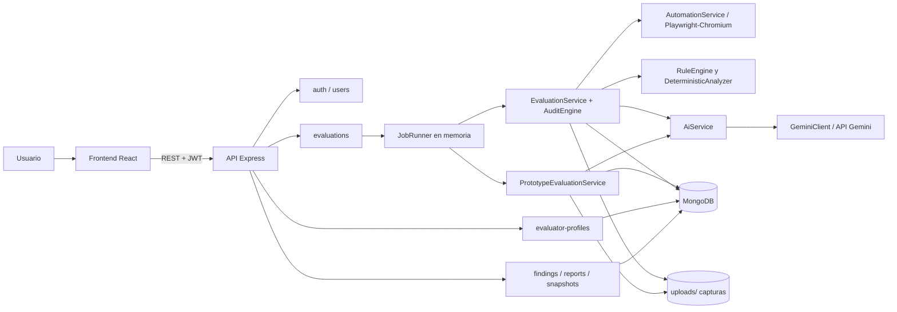

# Informe técnico-funcional de EvalUXIA para documentar la metodología de desarrollo

> Informe de análisis para revisión. **No es texto definitivo** del documento maestro.
> Fecha: 2026-10-24. Alcance: inspección del código actual del frontend (`/Users/isisrios/Proyectos/React/evaluxia`) y del backend (`/Users/isisrios/Proyectos/Node/evaluxia_backend`). No se modificó código, no se ejecutaron evaluaciones ni llamadas a Gemini.

**Etiquetas:** **[V]** verificado en código o ejecución de esta y la sesión anterior · **[I]** inferencia razonable · **[P]** pendiente de confirmar.
Las pruebas ejecutadas y sus resultados están en el informe previo `analisis_validacion_metodologica_evaluxia_fase3.md` (§2.2): frontend 33 pruebas pasan; backend 73 de 74 scripts pasan (1 falla por un artefacto de `/tmp` inexistente). No ejecuté nada más en esta sesión.

---

## 1. Resumen funcional de EvalUXIA

EvalUXIA es una plataforma web con frontend React y API Node/Express. Permite a un usuario autenticado evaluar la usabilidad y la accesibilidad de una interfaz bajo la perspectiva de un **perfil evaluador** (un usuario tipo ficticio que el usuario crea). Tiene dos modalidades [V]:

| | Sitio web por URL | Prototipo por imagen |
|---|---|---|
| Entrada | URL pública + título/descripción + perfil | Una imagen PNG/JPEG/WebP + título/descripción + perfil |
| Proceso | Exploración automatizada con Playwright/Chromium (3–8 iteraciones) y después auditoría | Una sola llamada multimodal a Gemini sobre la imagen |
| Análisis | Reglas determinísticas + IA sobre evidencia del DOM, estilos y árbol de accesibilidad | Solo IA sobre lo visible, con validadores locales |
| Criterios | 20 (10 Nielsen + 10 WCAG); 6 con verificación determinística | 19 definidos; 13 aplicables y 6 fuera de cobertura |
| Salida | Hallazgos `FAIL` persistidos + informe con puntaje, cobertura, cumplimiento y costos | Hallazgos `FAIL` persistidos + informe con puntaje y cobertura |

**Estado real [V/I]:** la modalidad web está en el historial de commits y tiene evidencias de ejecuciones reales (62 conjuntos de capturas en `uploads/`). La modalidad de prototipos está **implementada en código y probada con mocks, pero sin commitear y sin resultados de ejecución real persistidos** (ver §5.10 y §10).

---

## 2. Arquitectura actual

### 2.1 Responsabilidades

**Frontend** (`src/`): páginas (`pages/`), componentes (`components/evaluations`, `components/evaluator-profiles`), hooks (`useEvaluations`, `useEvaluatorProfiles`, `useFindings`, `useReport`), servicios HTTP con axios (`services/*`), estado global con Redux Toolkit + redux-persist (`features/auth`, `features/evaluatorProfiles`) y rutas protegidas (`routes/PrivateRoute.tsx`). Su función es capturar la entrada, iniciar la evaluación, **consultar periódicamente** su estado y mostrar resultados.

**Backend** (`src/`): estructura por módulos. Cada módulo suele tener *routes* (URL y middlewares), *controller* (traduce HTTP), *service* (lógica de negocio), *repository* (acceso a Mongoose) y *model* (esquema). Módulos: `auth`, `users`, `evaluator-profiles`, `evaluations`, `findings`, `reports`, `snapshots`, `ai-interactions`, `automation`, `ai`. El módulo `evaluations` concentra los servicios del motor (`evaluations/services/`). La infraestructura está en `infrastructure/` (MongoDB, Playwright, Gemini) y `shared/` (middlewares, errores, cola de trabajos, seguimiento de métricas, seguridad).

### 2.2 Separación de responsabilidades [V]

| Responsabilidad | Componente |
|---|---|
| Automatizar el navegador y capturar evidencia | `automation.service.ts` + `browser.manager.ts` (Playwright/Chromium) |
| Decisiones obvias de navegación | `rule-engine.service.ts` (reglas determinísticas) |
| Decisiones no obvias | Gemini mediante `ai.service.ts::makeDecision` |
| Verificaciones objetivas (contraste, alt, nombres, enlaces, encabezados, formularios) | `deterministic-analyzer.service.ts` |
| Interpretación semántica y heurísticas de Nielsen | Gemini (`performAuditAnalysis`, `performPrototypeAuditAnalysis`) |
| Control de calidad de lo que dice la IA | `evidence-gate`, `evidence-traceability`, `evidence-claim-consistency`, `visual-evidence-gate`, `visual-evidence-consistency`, `wcag-criterion-cardinality` |
| Consolidación y puntaje | `audit-metrics.service.ts`, `prototype-metrics.service.ts` |
| Orquestación | `evaluation.service.ts` + `audit-engine.service.ts` (web); `prototype-evaluation.service.ts` (imagen) |

### 2.3 Diagrama de la arquitectura

### 2.4 Comunicación frontend–backend [V]

REST bajo `/api/v1` con `Authorization: Bearer <accessToken>` (`apiClient.ts`). El frontend crea la evaluación (`POST /evaluations` o `/evaluations/prototype`), recibe un registro `pending`, y luego **consulta cada 2,5 s** (configurable con `VITE_POLLING_INTERVAL_MS`) `GET /evaluations/:id` hasta que termina, con un máximo de 10 minutos (`useEvaluations.ts`). Cuando `auditStatus` es `completed`, pide hallazgos (`/findings/evaluation/:id`) e informe (`/reports/evaluation/:id`). El refresco automático del token está pendiente: `apiClient.ts` solo deja un comentario TODO.

### 2.5 Diferencias arquitectónicas entre modalidades [V]

Web: dos fases (exploración + auditoría asíncrona), Playwright, evidencia estructurada (`SnapshotEvidence`), analizador determinístico. Imagen: un solo servicio, sin navegador, sin `SnapshotEvidence`, sin analizador determinístico, con almacenamiento del archivo en `uploads/prototypes/`.

---

## 3. Gestión de perfiles evaluadores

Archivos: `evaluator-profiles/*` (back), `pages/UserEvaluatorProfiles/*`, `components/evaluator-profiles/*`, `hooks/useEvaluatorProfiles.ts`, `features/evaluatorProfiles` (front).

### 3.1 Operaciones disponibles [V]

| Operación | Endpoint / UI | Comportamiento |
|---|---|---|
| Listar (paginado) | `GET /evaluator-profiles` | Solo los del usuario autenticado, más recientes primero |
| Consultar uno | `GET /:id` | 404 si no existe o no es del usuario |
| Crear | `POST /` | Si es el primer perfil del usuario, queda **activo** automáticamente |
| Editar | `PATCH /:id` | Esquema parcial; validación de Mongoose al guardar |
| Activar | `PATCH /:id/activate` | Desactiva todos los del usuario y activa el elegido (un único perfil activo) |
| Eliminar | `DELETE /:id` | Borra por `_id` + `userId` |
| **Desactivar** | **No existe** como operación separada: un perfil deja de estar activo solo cuando se activa otro |

El frontend muestra tarjetas de perfil (`EvaluatorProfileCard`), formulario de alta/edición, detalle, diálogo de confirmación de borrado y botón "activar". **No hay selector de perfil al iniciar una evaluación**: `EvaluateWebPage` y `EvaluatePrototypePage` usan el **perfil activo** (`profiles.find(p => p.isActive)`) y muestran `ActiveProfileCard`. Si no hay perfil activo, el formulario de evaluación no puede enviarse (`if (!activeProfile) return`).

### 3.2 Campos y su función [V]

| Grupo | Campos | Función |
|---|---|---|
| Identidad | `fullName`, `phrase`, `age`, `profession`, `maritalStatus`, `country`, `city` | Describir al usuario tipo |
| Arquetipo y relato | `archetype`, `biography`, `personality` | Contexto narrativo |
| Motivaciones | `goals[]` (1–10), `frustrations[]` (1–10) | Orientan qué buscaría y qué le molestaría |
| Capacidades y contexto | `techSavviness` (low/medium/high), `accessibilityNeeds[]`, `preferredDevice` (desktop/mobile/tablet) | Nivel técnico, necesidades de accesibilidad y dispositivo |
| Estado | `isActive` | Perfil seleccionado actualmente |

### 3.3 Validaciones [V]

Back (Zod, `evaluator-profile.dto.ts`): longitudes mínimas y máximas por campo (p. ej. `phrase` 5–300, `biography` 10–2000, `personality` 5–500), edad entera 0–120, metas y frustraciones con al menos una entrada, enumeraciones para `techSavviness` y `preferredDevice`. Front (Yup, formulario): requisitos equivalentes, con la edad mínima 1. Mongoose revalida en actualizaciones (`runValidators`).

### 3.4 Selección y validación al iniciar una evaluación [V]

El backend **exige** `evaluatorProfileId` en ambos esquemas de creación (`min(1)`). `evaluationService.create` y `prototypeEvaluationService.create` llaman a `evaluatorProfileService.findById(userId, id)`:
- Sin identificador: error de validación (400).
- Identificador inexistente, mal formado (`Types.ObjectId.isValid`) o **de otro usuario**: 404, porque la búsqueda es por `_id` y `userId`.
La obligatoriedad del perfil responde a que sus datos forman parte de los prompts; sin perfil no hay contexto de usuario tipo (el propósito del proyecto). Además la entidad `Evaluation` tiene `evaluatorProfileId` como campo requerido.

**Limitaciones [V]:** al eliminar un perfil no se comprueba si hay evaluaciones que lo referencian. Una evaluación ya terminada conserva el identificador, pero el historial no muestra el perfil (ver §8). En la auditoría web existe un perfil por defecto ("Usuario Simulado") si no se puede cargar el perfil (`audit-engine.service.ts`); en el flujo normal esto no ocurre porque se validó al crear.

### 3.5 Cómo entra el perfil en los prompts [V]

| Solicitud | Campos del perfil que recibe |
|---|---|
| Decisión de exploración web (Fase 1) | nombre, arquetipo, profesión, frase, personalidad, metas, frustraciones (`buildV2DecisionPrompt`). El contexto interno incluye más campos (edad, biografía, estado civil, país, ciudad) pero el prompt no los usa |
| Auditoría web (Fase 2) | nombre, arquetipo, profesión, frase, metas, frustraciones. **No** recibe `techSavviness`, `accessibilityNeeds` ni `preferredDevice` |
| Prototipo | nombre, arquetipo, profesión, frase, metas, frustraciones, `techSavviness`, `accessibilityNeeds`, `preferredDevice` y biografía truncada a 400 caracteres. Nunca estado civil, país ni ciudad (decisión documentada en el código) |

### 3.6 Qué influye en la exploración y qué solo en la interpretación [V/I]

- **Exploración (solo web):** el perfil entra en la decisión de Gemini cuando las reglas determinísticas no resuelven la acción; el tipo de recorrido puede variar según metas y frustraciones. No influye en las reglas determinísticas ni en la ejecución de las acciones.
- **Interpretación:** en la auditoría (web) y en el análisis visual (prototipo) el perfil contextualiza la redacción, la priorización y el criterio de los hallazgos de IA.
- **Verificaciones determinísticas [V]:** `DeterministicAnalyzer.analyzeSnapshots(evidences)` no recibe el perfil. Los resultados determinísticos no dependen de él.

### 3.7 Asimetría entre modalidades [V]

La modalidad de prototipos entrega a Gemini más atributos del perfil (nivel técnico, necesidades de accesibilidad, dispositivo) que la auditoría web. Es una discrepancia a documentar y, quizá, a resolver. El campo `affectedArchetypeTraits` del contrato de prototipos **no se persiste** (no existe en el modelo `Finding`).

---

## 4. Flujo completo de evaluación web

### A. Inicio de la evaluación [V]

1. **Entrada** (`EvaluationForm`): título (3–200), descripción opcional (≤1000; se usa como objetivo del recorrido), URL y perfil activo.
2. **Validaciones previas** (`CreateEvaluationSchema`): esquema Zod, URL válida y `assertSafeUrl` (anti-SSRF: bloquea destinos internos/privados, con pruebas en `url-guard.test.ts`).
3. **Registro:** `Evaluation` en estado `pending`, con `type: 'website'`, `url`, `evaluatorProfileId`, `userId`.
4. **Ejecución:** `jobRunner.add('evaluation', …)` programa la tarea con `setImmediate` en el mismo proceso. El `POST` responde enseguida con el registro.
5. **Estados:** `status`: `pending → running → completed | failed`. `auditStatus`: `pending → running → completed | failed`. Al arrancar el servidor, `reconcileStuckRunning` marca como `failed` toda evaluación o auditoría que había quedado en `running` (la cola no sobrevive a reinicios).

### B. Primera etapa: exploración automatizada [V]

**Qué se obtiene** (`automation.service.ts`): por iteración, un `PageSnapshot` con URL, título, **resumen de elementos interactivos visibles** (texto ≤100 caracteres, `aria-label` ≤150, selector CSS, rol, estado deshabilitado, si es primario), encabezados, imágenes, enlaces, botones, formularios, landmarks, **estilos computados** (hasta 50 elementos, con un conjunto de candidatos más amplio para la auditoría) y el **árbol de accesibilidad** mediante `ariaSnapshot()` de Playwright. La navegación usa `waitUntil: 'networkidle'`.

**Qué se conserva:** captura PNG (`uploads/evaluation_<id>_step_<n>.png`) y un `SnapshotEvidence` por iteración (`snapshot-evidence.service.ts`) con la evidencia estructurada.

**Preparación del contexto** (`context-builder.service.ts`): objeto con metadatos, descripción del flujo y objetivo del paso, estado del flujo (pasos completados, **solo las últimas 3 acciones**, error bloqueante), perfil, resumen DOM visible y restricciones (no asumir elementos ocultos, no inventar acciones, una acción por iteración). El contexto se valida con un esquema Zod antes de enviarse.

**Decisión entre reglas y Gemini:**
1. `RuleEngine.evaluate`: regla 0 (detener si la última acción falló o si se repitió la misma acción dos veces seguidas); regla 1 (sin elementos interactivos: detener); regla 2 (un único botón primario habilitado: hacer clic); regla 3 (un único elemento interactivo habilitado); regla 4 (coincidencia del objetivo con un botón de navegación obvio); regla 5 (secuencia escribir→enviar). Si una regla decide, **no se llama a Gemini** y esa iteración consume cero tokens.
2. Si no decide ninguna, `aiService.makeDecision` envía el prompt y valida la salida con Zod.

**Acciones que la IA puede proponer y se ejecutan:** `CLICK, TYPE, SELECT, CHECK, UNCHECK, HOVER, FOCUS, CLEAR, NAVIGATE, STOP_FLOW` (switch en `automation.service.ts::executeAction`). Las acciones con selector tienen un límite de 10 s. Solo se ejecuta una acción por iteración y solo cuando `recommendedNextStep` es `executeSuggestedAction`.

**Ciclo observar–decidir–ejecutar–observar:** el bucle de `evaluation.service.ts` repite snapshot → captura → evidencia → contexto → decisión → registro de la interacción (`ai-interactions`) → acción → actualización de `flowState`.

**Límite de iteraciones:** dinámico, entre **3 y 8** (`calculateDynamicMaxIterations`, según el número de campos editables, botones primarios y enlaces del snapshot inicial).

**Cuándo se detiene:** al alcanzar el máximo; si la decisión es `STOP_FLOW`; por la regla 0 (acción fallida o repetida); o por error fatal.

**Situaciones excepcionales [V]:**
- *Acción fallida:* `executeAction` devuelve `{success:false}`; `resolveActionOutcome` la registra como `failure`, guarda `blockingError`, y la siguiente iteración se detiene por la regla 0. La evaluación **sigue y termina como `completed`** y pasa a la auditoría.
- *Error de IA o de navegación:* el `catch` marca `status` y `auditStatus` como `failed` y guarda en `blockingError` un mensaje con prefijo `[AI_PROVIDER_ERROR n]` o `[EVALUATION_ERROR n]` y la iteración fallida. El navegador se cierra siempre en `finally`.
- *Respuesta inválida del proveedor:* el cliente valida con Zod; una respuesta inválida o vacía se trata como error transitorio y se reintenta (ver §7).
- *Payload excesivo:* si el prompt de decisión supera el presupuesto crítico se lanza un error 502 antes de llamar a Gemini.

**¿Terminó bien o incompleta?** `status=completed` no garantiza una exploración completa: una acción fallida puede truncarla. La señal es `flowState.blockingError` no nulo con `status=completed`; el frontend lo muestra con `IncompleteExplorationNotice`. No existe un campo explícito "exploración incompleta".

### C. Segunda etapa: auditoría y resultados [V]

Se ejecuta de forma asíncrona (`setImmediate` → `AuditEngine.performAudit`).

1. **Recupera** todos los `SnapshotEvidence` de la evaluación.
2. **Analizador determinístico** (6 análisis, sin IA): contraste (WCAG 1.4.3; umbral 4,5:1, o 3:1 para texto grande: ≥24 px, o ≥18,5 px en negrita; ignora fondos transparentes o indeterminables), imágenes (1.1.1), botones (4.1.2), enlaces (2.4.4), encabezados (1.3.1 / N-04) y formularios (3.3.2). Emite `PASS` o `FAIL` con evidencia.
3. **Prepara el contexto de IA** con deduplicación y priorización (ver §7).
4. **Gemini** (`performAuditAnalysis`) recibe: reglas absolutas ("NO EVIDENCE = NO FAIL"), contexto de sesión y perfil, resumen de evidencia por iteración (encabezados, imágenes, formularios), elementos compartidos deduplicados (landmarks, enlaces, botones), estilos computados priorizados y los árboles de accesibilidad. Le pide evaluar los 10 heurísticas de Nielsen y 8 criterios WCAG (1.1.1, 1.3.1, 1.4.1, 1.4.3, 2.4.4, 2.4.6, 3.3.2, 4.1.2), con **un único código WCAG por hallazgo**, recomendación concreta obligatoria para cada `FAIL`, y reglas específicas (p. ej. N-01 exige varias condiciones y no basta con que la URL no cambie).
5. **Validaciones de los hallazgos de IA** (todas degradan a `NOT_EVALUABLE`, nunca inventan ni corrigen):
   - `EvidenceGate` regla 0: el selector del hallazgo debe existir en el índice de evidencia **realmente enviado** a Gemini (J1); regla 0b: la evidencia citada debe referirse al mismo elemento; regla 0c: lo afirmado sobre el árbol de accesibilidad debe aparecer en el texto del árbol; regla 1: sin lenguaje especulativo ni `FAIL` sin evidencia.
   - Cardinalidad: un hallazgo = un criterio WCAG.
   - Consistencia de afirmaciones (`evidence-claim-consistency`): los pares propiedad/valor citados deben coincidir con el dato capturado.
6. **Consolidación** (`audit-metrics.service.ts`): une hallazgos determinísticos y de IA; deduplica por criterio + selector; fusiona evidencia. Ante **discrepancia de estado** (determinístico y IA discrepan en un mismo criterio y elemento) gana el determinístico y el veredicto de IA se conserva en `discrepancy`. Un `NOT_EVALUABLE` cede ante un veredicto decisivo.
7. **Métricas** calculadas en el backend; el puntaje que devuelva Gemini se ignora. Universo: 10 Nielsen + 10 WCAG. Cobertura = criterios con `PASS`/`FAIL` entre 20. Cumplimiento Nielsen/WCAG = `PASS / (PASS+FAIL)` por dominio. `overallScore = round(baseQuality × gamma)`, con `baseQuality = cumplimiento global − penalización de severidad normalizada` y `gamma = 0,5 + 0,5 × cobertura`.
8. **Persistencia:** se guardan **solo los hallazgos `FAIL`** como `Finding`. Se guarda un `Report` con conteos por severidad y por estado (`passCount`, `failCount`, `notEvaluableCount`), cumplimiento, cobertura, puntaje, métricas de tokens/costo/tiempo, número de iteraciones y de capturas. Los `PASS` y `NOT_EVALUABLE` solo existen como **conteos**.
9. **Mecanismo por criterio [V]:** *determinístico:* 1.4.3, 1.1.1, 4.1.2, 2.4.4, 1.3.1/N-04 (estructura de encabezados), 3.3.2. *Solo IA:* el resto de Nielsen (N-01…N-10), 1.4.1, 2.4.6 y la parte semántica de los criterios anteriores. *Sin evaluación posible por IA con el alcance actual:* 2.1.1 y 3.2.2 (comentarios en `ai.service.ts`; permanecen en el universo y cuentan en el denominador de cobertura).

---

## 5. Flujo completo de evaluación de prototipos visuales

### 5.1–5.3 Entrada, validaciones y registro [V]
- **Archivos:** PNG, JPEG o WebP. El formato se detecta por **firma binaria**, no por la extensión ni el tipo declarado; se rechazan SVG y GIF y los archivos renombrados. Máximo 10 MB y 8000 px por lado; el front repite el límite de 10 MB (`PrototypeEvaluationForm`).
- **Datos adicionales:** título (opcional, se usa la descripción si falta) y descripción obligatoria de 10 a 1000 caracteres, que explica la pantalla.
- **Registro:** el archivo se guarda en `uploads/prototypes/<uuid>.<ext>`; se crea la `Evaluation` (`type: 'prototype'`, `imageUrl`) en `running/running` y se encola un job. Solo se permite una imagen por evaluación; sin archivo, error 400.

### 5.4–5.6 Análisis multimodal y prompt [V]
El servicio lee el archivo, lo codifica en base64 y llama a `performPrototypeAuditAnalysis`, que envía **el texto del prompt y la imagen como parte multimodal separada**. El prompt define: la imagen como única fuente de verdad; prohibición de inferir DOM, teclado, lectores de pantalla o estados ocultos; lista de **criterios aplicables** (cada uno con su nota de alcance); un criterio principal por hallazgo; reglas de evidencia visual (todo ítem `VISUAL_OBSERVATION`, propiedades de una lista blanca, región en rejilla 3×3 o `full-screen`); regla de identidad (descripción específica del elemento); regla de abstención; regla de contraste (solo observación cualitativa; **prohibido** dar una razón numérica) y el contrato de salida JSON.

### 5.7–5.9 Restricción a la evidencia visual y validaciones [V]
Después de recibir la respuesta: `visual-evidence-gate` (propiedad fuera de lista blanca se elimina; `FAIL` sin evidencia, con baja confianza o con lenguaje especulativo pasa a `NOT_EVALUABLE`; un `PASS` sin evidencia también; si la región declarada contradice la evidencia, pasa a `NOT_EVALUABLE`; si la recomendación es solo el código de la heurística, se sustituye), cardinalidad de criterio y consistencia visual (`visual-evidence-consistency`: distingue consistente, inconsistente e insuficiente).

### 5.10 Criterios y cobertura [V]
Aplicables (13): WCAG 1.4.1 y 2.4.6 (directamente evaluables); 1.3.1, 1.4.3, 2.4.4, 1.1.1 y 3.3.2 (parcialmente, con notas); Nielsen N-02, N-03, N-04, N-05, N-06, N-08. **Fuera de cobertura (6):** WCAG 4.1.2, WCAG 2.1.1, N-01, N-07, N-09, N-10. Estos no se cuentan ni como evaluados ni como fallo.

### 5.11 Métricas y resultados [V]
`calculatePrototypeMetrics` calcula el puntaje (penalización por severidad: crítica 25, alta 15, media 8, baja 3, informativa 0) y la cobertura **solo sobre criterios aplicables**; los hallazgos sobre criterios fuera de lista se ignoran. Se persisten los `FAIL` y el `Report` con `coverage`. La consulta posterior usa los mismos endpoints y el mismo componente de resultados que la modalidad web.

### 5.12 Diferencias con la web [V]
No hay Playwright, DOM, árbol de accesibilidad, estilos computados, comprobación de interacciones, múltiples iteraciones ni analizador determinístico. El prompt lo prohíbe expresamente y el código no ejecuta esas operaciones. Los hallazgos de prototipo solo tienen `iteration: 1`, no tienen `screenshotUrl` y su referencia visual es `affectedElement.visualReference` (descripción + región).

### 5.13 Interfaz funcional y evidencia de ejecución
- **Frontend [V]:** ruta `/evaluate/prototype`, `EvaluatePrototypePage`, `PrototypeEvaluationForm` (selección de archivo, validación de tipo y tamaño, perfil activo) y sus pruebas (pasan). El historial y el resumen reutilizan los componentes web. **Sin commitear.**
- **Código vs. pruebas vs. ejecución real:**
  - *Implementado en código:* sí (§5.1–5.11).
  - *Probado con automatizaciones:* contratos, subida de imagen, persistencia y gates con mocks (`prototype-*.test.ts`, `visual-evidence-validation.test.ts`); ground truth con 3 imágenes (`prototype-ground-truth-matching`, `p7-contact-form-ground-truth`).
  - *Ejecución real verificada con resultados persistidos:* **no encontrada.** Existen runners con Gemini real protegidos por variable de entorno y una prueba que depende de resultados históricos en `/tmp` que ya no existen. Hay un archivo en `uploads/prototypes/` del 2026-10-16, compatible con al menos una evaluación real **[I]**; la base de datos no estaba disponible para confirmar su resultado.

---

## 6. Integración de Gemini y estructura de los prompts

### 6.1 Cliente [V]
`GeminiClient` (`@google/genai`) usa el modelo de `GEMINI_MODEL` (por defecto `gemini-2.5-flash`; `docker-compose.yml` usa `gemini-2.0-flash` por defecto: discrepancia). Solo configura `responseMimeType: 'application/json'`: **no declara un `responseSchema` del proveedor**. La estructura se exige en el prompt y se **valida con Zod** en el cliente; una respuesta que no cumple se trata como transitoria y se reintenta. No encontré configuración explícita de `temperature` ni `seed`.

### 6.2 Los tres prompts (más contratos) [V]

| Prompt | Propósito | Información que recibe | Contrato de salida |
|---|---|---|---|
| Decisión de exploración (`buildV2DecisionPrompt`) | Elegir **una** acción siguiente | Objetivo, paso actual, URL, perfil (7 campos), últimas 3 acciones, error bloqueante, **solo elementos interactivos visibles** | JSON con acción, selector, entrada, justificación, confianza y control de flujo |
| Auditoría web (`buildV2AuditPrompt`) | Hallazgos de Nielsen y WCAG basados en evidencia | Reglas "sin evidencia no hay `FAIL`", perfil (6 campos), historial, evidencia de todas las iteraciones, estilos priorizados, árboles ARIA | JSON con resumen y hallazgos (grupo, estado, severidad, confianza, criterio, descripción, evidencia, elemento, impacto, recomendación) |
| Prototipo (`buildPrototypeAuditPrompt`) | Auditoría visual de una imagen | Descripción, perfil (9 campos), criterios aplicables, lista blanca de propiedades visuales, la imagen | Mismo esquema de hallazgos con evidencia `VISUAL_OBSERVATION` y regiones |

El **perfil** se incluye siempre como contexto interpretativo, marcado en el prompt de prototipo como "NOT a real person, NOT an autonomous agent".

---

## 7. Estrategias de control de tokens, llamadas y costos

Todas **[V]** salvo indicación.

1. **Reglas determinísticas antes de IA:** cada iteración resuelta por `RuleEngine` evita una llamada a Gemini (`evaluation.service.ts`).
2. **Contexto mínimo en Fase 1:** solo elementos interactivos visibles y las últimas 3 acciones (ventana deslizante).
3. **Límites de iteraciones:** 3 a 8, calculado según la página.
4. **Menos llamadas en la auditoría:** una sola llamada de auditoría por evaluación web y una por prototipo.
5. **Deduplicación entre iteraciones:** landmarks, enlaces y botones idénticos se envían una vez con la lista de iteraciones en que aparecen (`evidence-deduplication.service.ts`).
6. **Priorización de estilos computados** (`evidence-prioritization.service.ts`): conjunto acotado, favoreciendo elementos ya respaldados por otra evidencia o con hallazgo determinístico, con un mínimo garantizado de elementos de texto. Se envían una sola vez.
7. **Compresión de evidencia:** el valor de `src` de las imágenes se transforma antes del prompt (`ai.service.ts`, "Evidence Compression"), sin modificar la evidencia guardada.
8. **Presupuestos de payload** (`payload-budgets.ts`): Fase 1: normal ≤30 000 caracteres, advertencia ≤100 000, crítico >100 000; Fase 2: 300 000 / 1 000 000. Un payload **crítico se bloquea antes de enviarse**: en Fase 1 detiene el flujo con error 502. En Fase 2 existe una salida alternativa en `performAuditAnalysis` **[I: vi solo el bloqueo de Fase 1; no leí por completo la rama de Fase 2]**.
9. **Salida estructurada y validación:** respuesta JSON validada con Zod.
10. **Reintentos con retroceso exponencial** (`AI_RETRY_CONFIG`: hasta 3 reintentos, 1 s inicial, factor 2, máximo 10 s, jitter de ±200 ms). Son reintentables 429, 502, 503, 504, errores de red transitorios y respuestas inválidas; no lo son 400, 401, 403 y 404.
11. **Métricas registradas** (`metrics-tracker.ts`, guardadas en `Report.metrics`): modelo, llamadas de Fase 1 y 2, tokens de entrada/salida/total, tokens de razonamiento (cuando el SDK los reporta), costo estimado en USD con tarifas configuradas (gemini-2.5-flash: 0,30 USD entrada y 2,50 USD salida por millón), costo acumulado desde el arranque y un campo `costStatus`. Cada interacción de IA se registra por iteración (`ai-interactions`).
12. **Límites de la medición [V]:** `totalExecutionTimeMs` suma solo la latencia de las llamadas a Gemini (no el tiempo de Playwright); el costo oficial usa los tokens del **último intento exitoso**, no el acumulado de reintentos (el acumulado solo se registra en logs); los *thinking tokens* no entran en el costo por falta de tarifa verificada; el acumulado global es en memoria y se pierde al reiniciar; las tarifas están escritas en código.
13. **No verificado:** no medí el ahorro real de tokens de cada técnica; no existe en el repositorio un resultado persistido que lo cuantifique. Los presupuestos fueron calibrados con fixtures de estrés (`payload-*.test.ts`) pero no tengo cifras reales de producción.
14. **Mejoras posibles (no implementadas):** persistir el costo acumulado, medir el tiempo total real, seleccionar el modelo por fase, y un límite de costo por evaluación.

---

## 8. Historial, persistencia y visualización de resultados

### 8.1 Identificación y consulta [V]
Una evaluación se identifica por su `_id` de MongoDB. `HistoryPage` lista las evaluaciones del usuario (paginadas, más recientes primero) con estado y auditoría, y refresca automáticamente mientras alguna esté `pending`/`running`. Al expandir una fila, el frontend carga hallazgos e informe solo si `auditStatus === 'completed'`.

### 8.2 Qué se muestra [V]
- **Resumen** (`EvaluationSummary`): puntaje y su cobertura (en prototipos, "evaluados de aplicables"), cumplimiento Nielsen y WCAG, conteos por severidad y por estado, y el consumo (tokens/costo/tiempo).
- **Hallazgos** (`FindingsAccordion`): severidad, criterio relacionado, descripción, impacto, **recomendación** y panel de evidencia técnica (tipo, propiedad, valor, selector).
- **Línea de tiempo** (`IterationTimeline`) con capturas por iteración (web).
- **Aviso** de exploración incompleta (`IncompleteExplorationNotice`) a partir de `flowState.blockingError`.
- **El historial no muestra el perfil usado**, aunque la evaluación lo tiene guardado.

### 8.3 Qué está en MongoDB y qué se calcula
| Persistido | Calculado en ejecución |
|---|---|
| `Evaluation` (estados, perfil, flujo), `Finding` (solo `FAIL`), `Report` (conteos, métricas, puntaje), `SnapshotEvidence` (web), `AiInteraction` (por iteración), `EvaluatorProfile`, `User` | Resumen de hallazgos del front (`buildFindingSummary`); métricas globales acumuladas (`GET /reports/metrics/cumulative`, en memoria); el aviso de exploración incompleta |

### 8.4 Limitaciones para interpretar los informes [V]
- Los hallazgos `PASS` y `NOT_EVALUABLE` **no se guardan individualmente**; el informe solo conoce sus totales. No se puede saber por criterio qué se evaluó como correcto.
- El origen (determinístico o IA) no se guarda, salvo en las discrepancias.
- En web, los hallazgos de IA quedan siempre asociados a la iteración 1 y a su captura (valores fijos en código).
- El puntaje no es comparable entre modalidades (distintos criterios y denominadores).

### 8.5 Restricciones de acceso [V]
Todas las rutas (salvo registro, inicio de sesión y renovación) requieren JWT. `Evaluation` y `EvaluatorProfile` se consultan por `_id` + `userId`; `Finding`, `Report` y `Snapshot` resuelven la propiedad a través de la evaluación padre. Un recurso ajeno devuelve 404.

---

## 9. Desarrollo iterativo e incremental: etapas y evidencias

Evidencia disponible: historial git (backend 12 commits, 2026-05-18 a 2026-09-06; frontend 10, 2026-02-25 a 2026-09-06), 91 archivos de prueba, 20 fixtures con resultado esperado y comentarios del código que citan hallazgos de ejecuciones reales. **El historial no refleja el trabajo posterior al 2026-09-06 (sin commitear).**

| Incremento | Evidencia | Qué se construyó |
|---|---|---|
| 1. Base y refactor | Commits "Initial commit" (18-may), "Refactor de módulos y modelos según análisis" (19-may); frontend "Add initial layouts" (25-feb) | Estructura modular |
| 2. MVP de backend | Commit del 4-jun: autenticación, perfiles, integración con IA | Auth JWT, perfiles, primera integración |
| 3. Autenticación en el frontend | Commit del 5-jun | JWT con persistencia de sesión |
| 4. Motor de dos fases | Commit "v2-architecture" (8-ago) | Exploración + auditoría, métricas en tiempo real |
| 5. Optimizaciones de exploración | Commit del 8-ago: acción `SELECT`, prevención de ciclos, ventana deslizante, iteraciones dinámicas | Reducción de llamadas y bucles |
| 6. Evidencia estructurada | "snapshot evidence" (8-ago) y "3A–3D" (9-ago) | `SnapshotEvidence`, auditoría basada en evidencia |
| 7. Visualización | "3E" y "3F" (9-ago) | Métricas, evidencias y línea de tiempo en el frontend |
| 8. Endurecimiento | Commits "Stage 2 + Phase A", "Phase B Gemini resilience", "Phase C.1" (6-sep) | Deduplicación, resiliencia ante fallos de Gemini, seguimiento de tokens |
| 9. Prototipos | Sin commitear (código presente) | Módulo de imágenes, gates visuales, criterios y su interfaz |

**Papel de las pruebas [V]:** *Unitarias y de contrato con mocks* (contratos Zod, gates, métricas, SSRF); *integración con base sintética* (resiliencia, persistencia); *escenarios con resultado esperado* (`fixtures/*/*.groundtruth.json`, con el oráculo `ground-truth-oracle.ts` y emparejadores de hallazgos); *runners con Gemini real* protegidos por variable de entorno; *scripts E2E* y de inspección de evaluaciones concretas (`run_e2e_validation_3d/3e/3f`, `run_e2e_launchpage_test`, `inspect_*`).

**Ejemplos concretos donde los resultados motivaron ajustes [V, por comentarios del código]:**
- Evaluación real de `launchpage.xyz` (7 iteraciones, 5 hallazgos, puntaje 24; Apéndice A del contexto): se detectaron un contraste medido de forma distinta por la regla y por Gemini (2,32:1 frente a 3,12:1), duplicación de criterios y un `N-01` sustentado solo en que la URL no cambió. De ahí la política de consolidación (`applyStatusConsolidationPolicy`, "hardening post Gemini Real #1"), la autoridad de la medición determinística y la regla específica de N-01.
- "Revisión MVP, post-evaluación real": regla 0c del Evidence Gate (afirmaciones sobre el árbol de accesibilidad) y el aviso de exploración incompleta tras observar un modal que bloqueaba los clics.
- La lista de criterios WCAG del prompt de auditoría tenía 7 de los 10 códigos soportados; se completó.
- Los presupuestos de payload se calibraron con fixtures de estrés (`t2…t7`, `f1…f8`).

**Limitaciones de la evidencia:** los mensajes de commit son breves y varios agrupan mucho trabajo ("checkpoint"); la mayor parte del endurecimiento está sin commitear; no hay registro de las sesiones de pruebas reales salvo capturas y comentarios; no encontré artefactos de Scrum/XP de EvalUXIA; no encontré evidencia de sesiones con usuarios durante el desarrollo, por lo que **no debe afirmarse DCU aplicado con usuarios**. El resultado de los experimentos reales se escribía en `/tmp` y se perdió.

**Caracterización respaldada:** proceso iterativo e incremental con ciclos de construcción, prueba y endurecimiento, guiado por casos de prueba con resultados esperados y por observaciones de ejecuciones reales.

---

## 10. Pruebas y estado real de implementación

| Funcionalidad | Código | Pruebas automatizadas | Ejecución real verificada | Observaciones |
|---|---|---|---|---|
| Autenticación y perfiles (back) | Sí | Sí (varias, algunas con BD no ejecutadas hoy) | [I] uso en desarrollo | — |
| Autenticación en el front | Parcial | — | — | Sin renovación de token ni registro en la UI |
| Evaluación web completa | Sí | Mocks, fixtures y E2E (los E2E no se ejecutaron hoy) | Sí, vestigios (capturas, `launchpage.xyz`) | BD no consultada |
| Analizador determinístico | Sí | Sí (ejecutadas hoy: formularios, etc.) | [I] | 6 criterios |
| Gates de evidencia | Sí | Sí | [I] | — |
| Resiliencia ante fallos de IA | Sí | Sí (`gemini-resilience`, ejecutada hoy) | [P] | — |
| Seguimiento de tokens y costo | Sí | Sí | [I] | Limitaciones en §7.12 |
| Prototipos por imagen | Sí | Mocks y ground truth | **Sin evidencia persistida** | Sin commitear |
| Frontend de prototipos | Sí | Sí (pasan) | — | Sin commitear |
| Flujos por descripción libre (`flowDefinition`) | Solo modelo | — | — | Sin ruta en el front |
| Persistencia de cola | No | — | — | `JobRunner` en memoria; se reconcilian los trabajos atascados al reiniciar |
| CI/CD | No evidenciado | — | — | — |

**Limitaciones técnicas relevantes:** variabilidad de IA sin `temperature`/`seed`, cola en memoria, límites del contenido dinámico, imágenes únicas, solo `FAIL` persistidos, `totalExecutionTimeMs` parcial.

---

## 11. Limitaciones, asimetrías y discrepancias encontradas

| # | Hallazgo | Tipo |
|---|---|---|
| 1 | El perfil que reciben los prompts difiere entre modalidades y entre la fase de decisión y la de auditoría | Asimetría |
| 2 | No hay selector de perfil por evaluación; se usa el perfil activo | Diseño del front |
| 3 | El historial no muestra el perfil de cada evaluación | Limitación de UI |
| 4 | Eliminar un perfil no verifica evaluaciones que lo referencian | Limitación |
| 5 | Solo se persisten los `FAIL`; el origen no se guarda | Limitación para informes |
| 6 | Hallazgos de IA web fijados a iteración 1 y captura del paso 1 | Defecto de trazabilidad |
| 7 | No se declara `responseSchema` en Gemini; la estructura se valida después | Matiz (no hay "salida estructurada" nativa del proveedor) |
| 8 | Modelo por defecto distinto en `env.ts` y `docker-compose.yml` | Discrepancia |
| 9 | Un recorrido truncado queda `completed`; solo `blockingError` lo indica | Limitación |
| 10 | `framer-motion`, `lottie-react`, `@playwright/test` y `jest` declarados sin uso; Tailwind sin uso evidenciado | Dependencias sin uso |
| 11 | Informes previos indicaban 7 criterios WCAG en el prompt; hoy son 8 (y 10 en el universo) | Corrección |
| 12 | El documento maestro menciona "Marco legal" y "Diseño de la solución"; la guía pide "Marco Jurídico" y "Diseño preliminar del prototipo" | Documentación |
| 13 | El documento maestro afirma que la interfaz "configura los parámetros disponibles" para la evaluación web: en el formulario solo hay título, descripción, URL y perfil | Precisión |
| 14 | El marco tecnológico del documento menciona MUI, Playwright, Gemini, Mongoose; no menciona Zod, Redux Toolkit ni JWT, que sí existen | Completitud |

---

## 12. Propuesta de contenido para el documento de grado

Nivel intermedio: procesos, responsabilidades y decisiones de diseño. Evitar código y nombres de archivo en el cuerpo; moverlos a anexos si hace falta.

### 12.1 Metodología de desarrollo de software
- Describir el proceso como **iterativo e incremental** (Sommerville, 2016, ya citado), y justificarlo con la evolución verificable: base modular → MVP → motor de dos fases → evidencia estructurada → visualización → endurecimiento → prototipos (tabla de §9, en forma resumida, con fechas de commits).
- Explicar el **ciclo construir–probar–endurecer** con tres o cuatro ejemplos concretos de §9 (p. ej. el caso del contraste medido de dos maneras que llevó a la consolidación con prioridad determinística).
- Describir el papel de las pruebas: tipos y propósito, y el uso de escenarios con resultado esperado.
- Aclarar lo que **no** se afirma: ni Scrum, ni XP, ni DCU con usuarios; el DCU es un marco de referencia que inspira los perfiles evaluadores. Incluir una línea de limitaciones sobre la evidencia disponible.
- Cuidado con el tiempo verbal: lo hecho en pasado, la validación en futuro.
- Recomendación práctica: hacer commit del trabajo antes de la entrega para que el historial respalde la descripción.

### 12.2 Análisis de requerimientos
- **Funcionales** agrupados por módulo: gestión de usuarios y sesión; gestión de perfiles evaluadores (crear, consultar, editar, activar, eliminar; un perfil activo); evaluación por URL (validación segura de la URL, exploración automatizada, auditoría, informe); evaluación de prototipos (carga y validación de imagen, análisis visual, cobertura declarada); hallazgos (severidad, criterio, evidencia, recomendación); informe y métricas; historial y consulta.
- **No funcionales** con su mecanismo: seguridad (JWT, anti-SSRF, aislamiento por usuario, validación de archivos), confiabilidad (reintentos, reconciliación de trabajos atascados, manejo de errores), trazabilidad de evidencia (gates), control de consumo (presupuesto de payload, deduplicación, métricas), honestidad del análisis (`NOT_EVALUABLE` en lugar de adivinar; criterios fuera de cobertura en prototipos).
- Indicar, sin ocultarlo, lo **parcial o pendiente:** renovación de token en el front, persistencia de la cola, persistencia de resultados no `FAIL`, flujos por descripción libre.
- Relacionar cada requerimiento con un objetivo específico (OE2: módulos; OE3: perfiles y resultados; OE4: verificación).

### 12.3 Diseño de la solución
- Arquitectura en capas (frontend, API, motor de evaluación, persistencia, servicios externos) con el diagrama de §2.3.
- Diagrama y explicación de **los dos flujos** (§4 y §5), poniendo énfasis en la diferencia: web = exploración + auditoría; imagen = análisis visual único.
- **Decisiones de diseño con su razón:** reglas determinísticas antes de IA (costo y fiabilidad); la IA decide solo lo que las reglas no resuelven; "sin evidencia no hay fallo"; los gates como control de calidad; el perfil como contexto, no como agente; la cobertura declarada de prototipos; el puntaje calculado por el backend.
- El perfil evaluador: atributos, validaciones, activación, uso en prompts, y su alcance (no afecta lo determinístico).
- Cómo se presentan los resultados (resumen, hallazgos, evidencias, línea de tiempo) y las limitaciones de interpretación (§8.4).
- Un breve apartado de **prototipo de interfaz:** pantallas (inicio de sesión, perfiles, evaluar web, evaluar prototipo, historial), con capturas reales de la aplicación.

### 12.4 Antes de redactar [P]
1. Confirmar con la base de datos el número de evaluaciones reales completadas por modalidad.
2. Decidir si se alinea la asimetría de perfil entre modalidades o se documenta tal cual.
3. Hacer commit del trabajo reciente.
4. Verificar las cifras de tarifas y el modelo utilizado antes de citar costos.
5. Revisar si la descripción "configura los parámetros" del documento maestro debe ajustarse.
